# TÀI LIỆU ĐẶC TẢ YÊU CẦU PHẦN MỀM

## SOFTWARE REQUIREMENT SPECIFICATION – SRS

### HỆ THỐNG GIÁM SÁT NHIỆT ĐỘ, BẬT TẮT THIẾT BỊ PHÒNG HỌC

---

# 1. GIỚI THIỆU

## 1.1 Mục đích

Tài liệu Đặc tả Yêu cầu Phần mềm (Software Requirement Specification – SRS) này nhằm mô tả chi tiết các yêu cầu chức năng của hệ thống **“Giám sát nhiệt độ, bật tắt thiết bị phòng học”**, làm cơ sở thống nhất trong quá trình phân tích, thiết kế, phát triển, kiểm thử và nghiệm thu hệ thống.

Tài liệu tập trung mô tả các chức năng mà người dùng có thể tương tác trên hệ thống, bao gồm:

- Đăng nhập vào hệ thống.
- Theo dõi dữ liệu nhiệt độ và ánh sáng theo thời gian thực.
- Theo dõi biểu đồ biến động của các giá trị cảm biến.
- Điều khiển bật/tắt quạt và bóng đèn.
- Tra cứu và thống kê dữ liệu cảm biến.
- Theo dõi lịch sử bật/tắt thiết bị.
- Xem thông tin cá nhân và các tài nguyên liên quan đến dự án.

Tài liệu đồng thời đặc tả các tác nhân, các use case, quy trình nghiệp vụ và yêu cầu giao diện, giúp đội phát triển có thể dựa vào đó để triển khai hệ thống và giúp đội kiểm thử xây dựng các trường hợp kiểm thử tương ứng.

---

## 1.2 Phạm vi

### Lý do lựa chọn đề tài

Trong phòng học, các yếu tố môi trường như nhiệt độ và ánh sáng ảnh hưởng trực tiếp đến điều kiện học tập. Tuy nhiên, việc theo dõi các yếu tố này và điều khiển các thiết bị như quạt, bóng đèn thông thường vẫn được thực hiện thủ công.

Việc ứng dụng Internet of Things (IoT) cho phép dữ liệu môi trường được thu thập liên tục thông qua cảm biến, đồng thời cho phép người dùng theo dõi và điều khiển thiết bị từ một hệ thống tập trung.

Vì vậy, nhóm lựa chọn đề tài **“Hệ thống giám sát nhiệt độ, bật tắt thiết bị phòng học”** nhằm áp dụng các kiến thức về IoT, cảm biến, lập trình Web, cơ sở dữ liệu và truyền dữ liệu thời gian thực vào một bài toán có tính thực tế.

### Phạm vi chức năng

Phạm vi của tài liệu bao gồm việc đặc tả 5 chức năng chính của hệ thống:

1. **Đăng nhập (Authentication)**\
   Xác thực người dùng trước khi cho phép truy cập các chức năng của hệ thống.

2. **Dashboard**\
   Hiển thị dữ liệu nhiệt độ và ánh sáng theo thời gian thực, biểu đồ biến động của dữ liệu cảm biến và khu vực điều khiển quạt, bóng đèn.

3. **Data Sensor**\
   Hiển thị, tìm kiếm, lọc và sắp xếp dữ liệu cảm biến đã được hệ thống ghi nhận.

4. **History**\
   Hiển thị và tra cứu lịch sử bật/tắt các thiết bị.

5. **Profile**\
   Hiển thị thông tin cá nhân của người dùng và các liên kết tài nguyên của dự án.

Ngoài ứng dụng Web, hệ thống có thành phần thiết bị IoT chịu trách nhiệm:

- Thu thập nhiệt độ.
- Thu thập cường độ ánh sáng.
- Gửi dữ liệu cảm biến đến hệ thống.
- Nhận lệnh điều khiển quạt.
- Nhận lệnh điều khiển bóng đèn.
- Phản hồi trạng thái thiết bị sau khi thực hiện lệnh.

---

## 1.3 Từ điển thuật ngữ

| Thuật ngữ          | Định nghĩa                                                                                                 |
| ------------------ | ---------------------------------------------------------------------------------------------------------- |
| SRS                | Software Requirement Specification – Tài liệu đặc tả yêu cầu phần mềm                                      |
| Use Case           | Mô tả cách một tác nhân tương tác với hệ thống để đạt được một mục tiêu cụ thể                             |
| Actor              | Tác nhân tương tác với hệ thống                                                                            |
| User               | Người sử dụng hệ thống                                                                                     |
| IoT                | Internet of Things – Mạng lưới các thiết bị có khả năng thu thập, trao đổi dữ liệu và thực hiện điều khiển |
| IoT Device         | Thiết bị phần cứng chịu trách nhiệm đọc cảm biến và điều khiển thiết bị điện                               |
| Sensor             | Cảm biến dùng để thu thập dữ liệu môi trường                                                               |
| Temperature Sensor | Cảm biến đo nhiệt độ                                                                                       |
| Light Sensor       | Cảm biến đo cường độ ánh sáng                                                                              |
| Dashboard          | Màn hình tổng quan hiển thị dữ liệu thời gian thực, biểu đồ và trạng thái thiết bị                         |
| Data Sensor        | Chức năng tra cứu và thống kê dữ liệu cảm biến                                                             |
| Device             | Thiết bị điện có thể được điều khiển bởi hệ thống, gồm quạt và bóng đèn                                    |
| Action             | Hành động điều khiển thiết bị, gồm bật hoặc tắt                                                            |
| History            | Lịch sử các thao tác bật/tắt thiết bị                                                                      |
| Profile            | Màn hình hiển thị thông tin cá nhân và tài nguyên dự án                                                    |
| Realtime           | Dữ liệu được cập nhật gần thời điểm dữ liệu được thiết bị ghi nhận                                         |
| ON                 | Thiết bị đang ở trạng thái bật                                                                             |
| OFF                | Thiết bị đang ở trạng thái tắt                                                                             |
| LOADING            | Hệ thống đang chờ thiết bị thực hiện và phản hồi kết quả của lệnh điều khiển                               |
| Lux                | Đơn vị đo độ rọi/cường độ ánh sáng                                                                         |
| °C                 | Đơn vị đo nhiệt độ theo độ Celsius                                                                         |

---

# 2. CÁC YÊU CẦU CHỨC NĂNG

## 2.1 Các tác nhân

Hệ thống có hai tác nhân chính:

### Người dùng – User

Người dùng là tác nhân trực tiếp sử dụng ứng dụng Web.

Người dùng có thể:

- Đăng nhập vào hệ thống.
- Theo dõi Dashboard.
- Xem dữ liệu cảm biến thời gian thực.
- Xem biểu đồ nhiệt độ và ánh sáng.
- Điều khiển quạt và bóng đèn.
- Tra cứu dữ liệu cảm biến.
- Xem lịch sử bật/tắt thiết bị.
- Xem thông tin Profile.

### Thiết bị IoT – IoT Device

Thiết bị IoT là tác nhân bên ngoài giao tiếp với hệ thống để:

- Đọc giá trị cảm biến nhiệt độ.
- Đọc giá trị cảm biến ánh sáng.
- Gửi dữ liệu cảm biến lên hệ thống.
- Nhận yêu cầu bật/tắt thiết bị.
- Điều khiển quạt và bóng đèn.
- Phản hồi trạng thái của thiết bị.

---

## 2.2 Các chức năng của hệ thống

### Đăng nhập

Xác thực người dùng trước khi cho phép truy cập vào các chức năng của hệ thống.

### Dashboard

Dashboard là màn hình tổng quan của hệ thống, bao gồm ba nhóm chức năng chính:

- Hiển thị giá trị nhiệt độ và ánh sáng theo thời gian thực.
- Hiển thị biểu đồ biến động nhiệt độ và ánh sáng.
- Hiển thị và điều khiển trạng thái quạt, bóng đèn.

### Data Sensor

Cho phép người dùng xem các bản ghi dữ liệu cảm biến đã được lưu trong hệ thống.

Hệ thống hỗ trợ:

- Hiển thị danh sách dữ liệu.
- Tìm kiếm theo thời gian.
- Lọc theo thời gian.
- Lọc theo nhiệt độ.
- Lọc theo ánh sáng.
- Sắp xếp dữ liệu.
- Phân trang.

### History

Cho phép người dùng xem lịch sử thao tác bật/tắt thiết bị.

Hệ thống hỗ trợ:

- Hiển thị danh sách lịch sử.
- Tìm kiếm theo thời gian.
- Lọc theo thiết bị.
- Lọc theo hành động.
- Lọc theo trạng thái.
- Sắp xếp.
- Phân trang.

### Profile

Cho phép người dùng xem:

- Ảnh đại diện.
- Họ và tên.
- Mã sinh viên.
- Lớp.
- Email.
- Link GitHub.
- Link Figma.
- Link Postman.
- Link báo cáo.

Các sơ đồ use case dưới đây mô hình hóa các tác nhân và chức năng của hệ thống.

---

# 2.3 Biểu đồ use case tổng quát

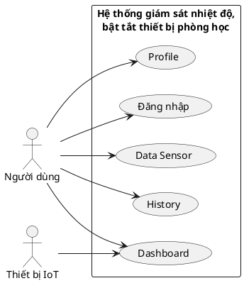

Người dùng phải thực hiện đăng nhập trước khi sử dụng Dashboard, Data Sensor, History và Profile.

Thiết bị IoT tương tác với hệ thống trong quá trình thu thập dữ liệu cảm biến và điều khiển thiết bị trên Dashboard.

---

# 2.4 Biểu đồ use case phân rã

## 2.4.1 Biểu đồ phân rã use case Đăng nhập

Use case Đăng nhập được phân rã thành:

- Nhập thông tin đăng nhập.
- Kiểm tra dữ liệu đầu vào.
- Xác thực tài khoản.
- Tạo phiên đăng nhập.
- Chuyển tới Dashboard.

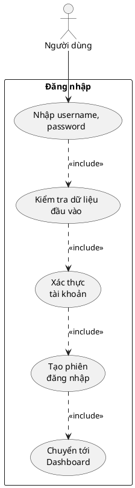

---

## 2.4.2 Biểu đồ phân rã use case Dashboard

Dashboard bao gồm:

- Xem nhiệt độ thời gian thực.
- Xem ánh sáng thời gian thực.
- Xem biểu đồ nhiệt độ.
- Xem biểu đồ ánh sáng.
- Xem trạng thái thiết bị.
- Bật thiết bị.
- Tắt thiết bị.
- Cập nhật trạng thái thiết bị.

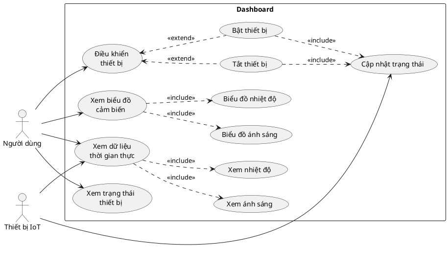

---

## 2.4.3 Biểu đồ phân rã use case Data Sensor

Data Sensor bao gồm:

- Xem danh sách dữ liệu cảm biến.
- Tìm kiếm theo thời gian.
- Lọc dữ liệu.
- Lọc theo thời gian.
- Lọc theo nhiệt độ.
- Lọc theo ánh sáng.
- Sắp xếp.
- Phân trang.

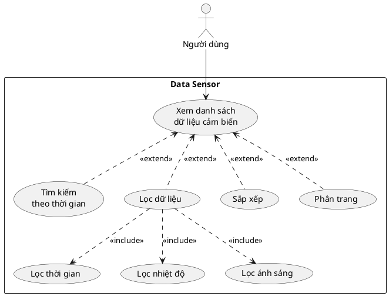

---

## 2.4.4 Biểu đồ phân rã use case History

History bao gồm:

- Xem danh sách lịch sử.
- Tìm kiếm theo thời gian.
- Lọc theo thiết bị.
- Lọc theo hành động.
- Lọc theo trạng thái.
- Sắp xếp.
- Phân trang.

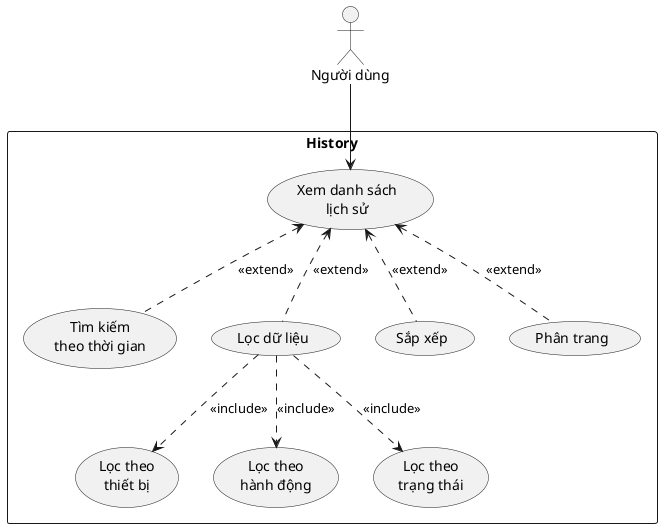

---

## 2.4.5 Biểu đồ phân rã use case Profile

Profile bao gồm:

- Xem ảnh đại diện.
- Xem thông tin cá nhân.
- Xem GitHub.
- Xem Figma.
- Xem Postman.
- Xem báo cáo.

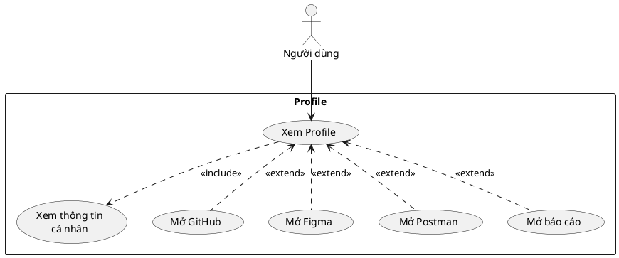

---

# 2.5 Quy trình nghiệp vụ

## 2.5.1 Quy trình sử dụng phần mềm

Sau khi có tài khoản, người dùng truy cập hệ thống và thực hiện đăng nhập.

Nếu thông tin đăng nhập hợp lệ, hệ thống chuyển người dùng đến Dashboard. Tại đây người dùng có thể theo dõi nhiệt độ, ánh sáng, biểu đồ biến động và trạng thái các thiết bị.

Người dùng có thể lựa chọn các chức năng khác trên hệ thống gồm:

- Dashboard.
- Data Sensor.
- History.
- Profile.

Khi người dùng thao tác bật hoặc tắt thiết bị trên Dashboard, hệ thống gửi yêu cầu điều khiển tới thiết bị IoT. Trong thời gian chờ thiết bị thực hiện lệnh, trạng thái được hiển thị là `LOADING`. Sau khi nhận phản hồi, hệ thống cập nhật trạng thái thành `ON` hoặc `OFF` và ghi nhận thao tác vào lịch sử.

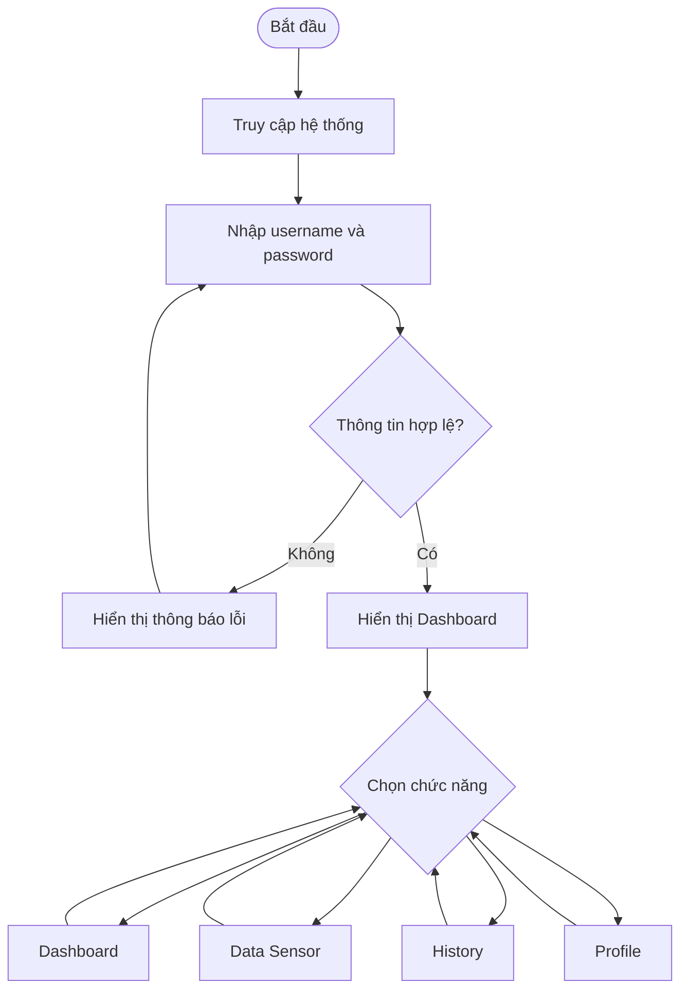

---

## 2.5.2 Quy trình đăng nhập

1. Người dùng truy cập hệ thống.
2. Hệ thống hiển thị màn hình đăng nhập.
3. Người dùng nhập Username và Password.
4. Người dùng nhấn nút **Đăng nhập**.
5. Hệ thống kiểm tra dữ liệu đầu vào.
6. Hệ thống xác thực tài khoản.
7. Nếu thông tin đúng, hệ thống tạo phiên đăng nhập.
8. Hệ thống chuyển người dùng đến Dashboard.
9. Nếu thông tin không đúng, hệ thống hiển thị thông báo lỗi và cho phép nhập lại.

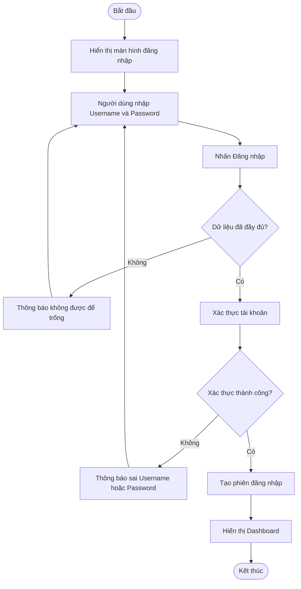

---

## 2.5.3 Quy trình giám sát dữ liệu cảm biến

Thiết bị IoT liên tục thu thập dữ liệu từ cảm biến nhiệt độ và ánh sáng.

Khi có dữ liệu mới, thiết bị gửi dữ liệu tới hệ thống. Hệ thống ghi nhận dữ liệu và cập nhật giá trị mới trên Dashboard.

Biểu đồ nhiệt độ và ánh sáng cũng được cập nhật theo dữ liệu mới nhận được.

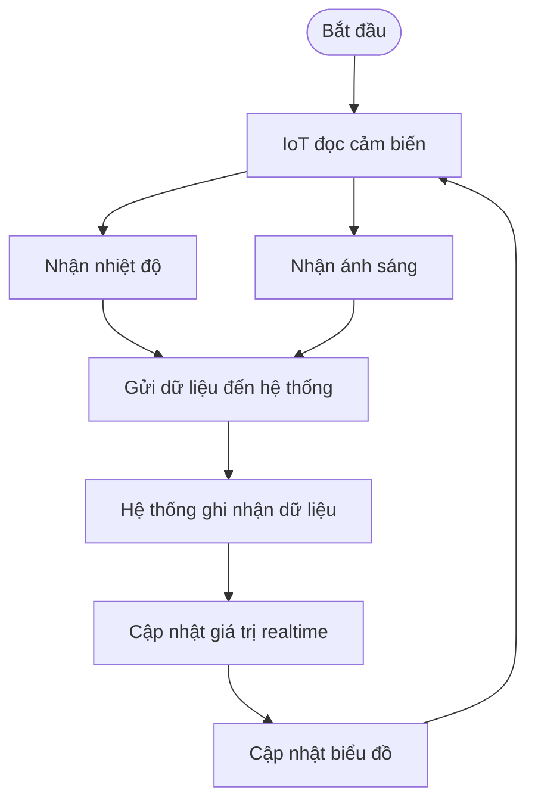

---

## 2.5.4 Quy trình bật/tắt thiết bị

1. Người dùng mở Dashboard.
2. Hệ thống hiển thị trạng thái hiện tại của quạt và bóng đèn.
3. Người dùng chọn thiết bị.
4. Người dùng thực hiện thao tác bật hoặc tắt.
5. Hệ thống chuyển trạng thái thiết bị sang `LOADING`.
6. Hệ thống gửi lệnh điều khiển tới thiết bị IoT.
7. Thiết bị IoT thực hiện lệnh.
8. Thiết bị phản hồi trạng thái.
9. Hệ thống cập nhật trạng thái thành `ON` hoặc `OFF`.
10. Hệ thống ghi nhận thao tác vào History.

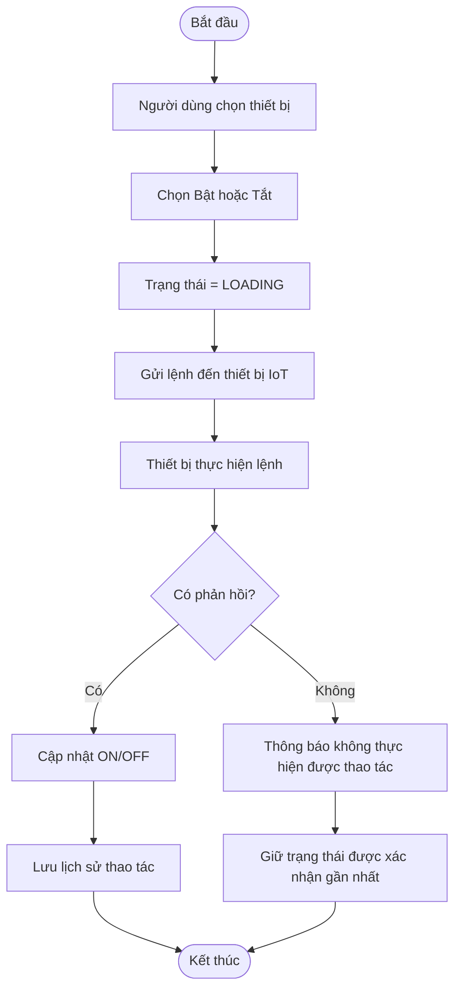

---

## 2.5.5 Quy trình tra cứu dữ liệu cảm biến

1. Người dùng chọn chức năng Data Sensor.
2. Hệ thống hiển thị danh sách dữ liệu cảm biến.
3. Người dùng có thể nhập điều kiện tìm kiếm hoặc bộ lọc.
4. Hệ thống kiểm tra điều kiện.
5. Hệ thống tìm các bản ghi phù hợp.
6. Hệ thống sắp xếp và hiển thị kết quả.
7. Nếu không có dữ liệu phù hợp, hệ thống hiển thị trạng thái không có kết quả.

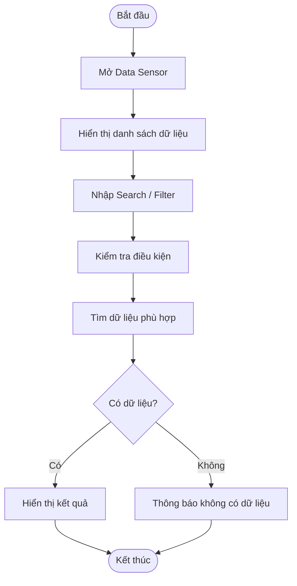

---

## 2.5.6 Quy trình tra cứu lịch sử bật/tắt

1. Người dùng chọn chức năng History.
2. Hệ thống hiển thị danh sách lịch sử.
3. Người dùng nhập thời gian tìm kiếm hoặc lựa chọn bộ lọc.
4. Hệ thống tìm kiếm dữ liệu phù hợp.
5. Hệ thống hiển thị kết quả.

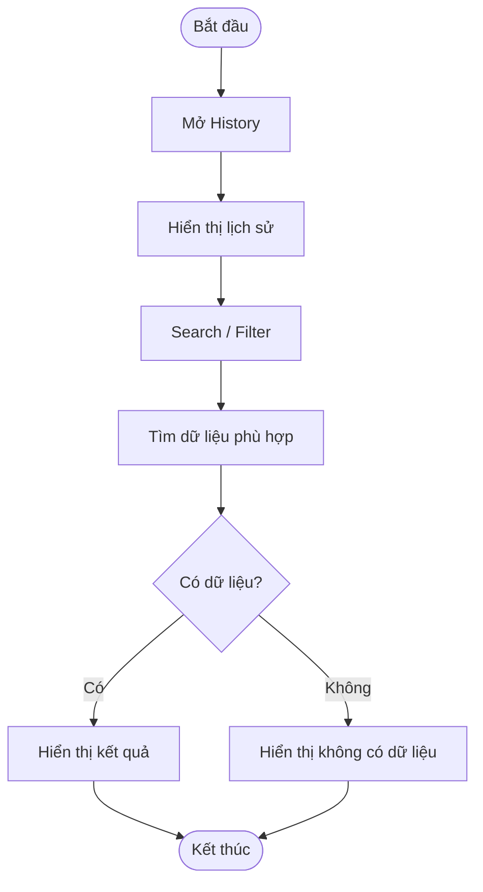

---

## 2.5.7 Quy trình xem Profile

1. Người dùng chọn Profile.
2. Hệ thống lấy thông tin Profile.
3. Hệ thống hiển thị thông tin cá nhân.
4. Hệ thống hiển thị các liên kết dự án.
5. Người dùng có thể chọn một liên kết.
6. Hệ thống mở tài nguyên tương ứng.

---

# 2.6 Đặc tả các use case

# 2.6.1 Đặc tả chi tiết use case “Đăng nhập”

| Thuộc tính            | Nội dung                                                                        |
| --------------------- | ------------------------------------------------------------------------------- |
| **Mã use case**       | US01                                                                            |
| **Tên Use case**      | Đăng nhập                                                                       |
| **Tác nhân**          | User                                                                            |
| **Mô tả**             | Use case cho phép người dùng xác thực tài khoản để truy cập và sử dụng hệ thống |
| **Sự kiện kích hoạt** | Người dùng nhấn nút “Đăng nhập” trên màn hình đăng nhập                         |
| **Tiền điều kiện**    | Người dùng đã có tài khoản hợp lệ trên hệ thống                                 |

### Luồng sự kiện chính

| STT | Thực hiện bởi | Hành động                                        |
| --: | ------------- | ------------------------------------------------ |
|   1 | Người dùng    | Truy cập hệ thống                                |
|   2 | Hệ thống      | Hiển thị form đăng nhập gồm Username và Password |
|   3 | Người dùng    | Nhập Username                                    |
|   4 | Người dùng    | Nhập Password                                    |
|   5 | Người dùng    | Nhấn nút “Đăng nhập”                             |
|   6 | Hệ thống      | Kiểm tra dữ liệu đầu vào                         |
|   7 | Hệ thống      | Kiểm tra thông tin tài khoản                     |
|   8 | Hệ thống      | Xác thực thành công                              |
|   9 | Hệ thống      | Tạo phiên đăng nhập cho người dùng               |
|  10 | Hệ thống      | Chuyển người dùng đến Dashboard                  |

### Luồng sự kiện thay thế

| Mã | Thực hiện bởi | Hành động                                                                             |
| -- | ------------- | ------------------------------------------------------------------------------------- |
| 6a | Hệ thống      | Nếu Username hoặc Password để trống, hiển thị thông báo yêu cầu nhập đầy đủ thông tin |
| 7a | Hệ thống      | Nếu tài khoản không tồn tại, hiển thị thông báo “Sai tên đăng nhập hoặc mật khẩu”     |
| 7b | Hệ thống      | Nếu mật khẩu không chính xác, hiển thị thông báo “Sai tên đăng nhập hoặc mật khẩu”    |
| 7c | Hệ thống      | Nếu không thể thực hiện xác thực do lỗi hệ thống, thông báo lỗi và use case kết thúc  |

### Hậu điều kiện

**Thành công:** Người dùng đăng nhập vào hệ thống và được chuyển tới Dashboard.

**Thất bại:** Người dùng vẫn ở màn hình đăng nhập, không được truy cập các chức năng yêu cầu xác thực.

### Dữ liệu đầu vào

| STT | Trường dữ liệu | Mô tả         | Bắt buộc | Điều kiện hợp lệ    | Ví dụ            |
| --: | -------------- | ------------- | -------- | ------------------- | ---------------- |
|   1 | Username       | Tên đăng nhập | Có       | Không được để trống | student01        |
|   2 | Password       | Mật khẩu      | Có       | Không được để trống | \*\*\*\*\*\*\*\* |

---

# 2.6.2 Đặc tả chi tiết use case “Dashboard”

| Thuộc tính            | Nội dung                                                                                               |
| --------------------- | ------------------------------------------------------------------------------------------------------ |
| **Mã use case**       | US02                                                                                                   |
| **Tên Use case**      | Dashboard                                                                                              |
| **Tác nhân**          | User, IoT Device                                                                                       |
| **Mô tả**             | Cho phép người dùng theo dõi dữ liệu cảm biến thời gian thực, biểu đồ biến động và điều khiển thiết bị |
| **Sự kiện kích hoạt** | Người dùng truy cập Dashboard sau khi đăng nhập hoặc chọn “Dashboard”                                  |
| **Tiền điều kiện**    | Người dùng đã đăng nhập thành công                                                                     |

## Xem dữ liệu cảm biến thời gian thực

### Luồng sự kiện chính

| STT | Thực hiện bởi | Hành động                            |
| --: | ------------- | ------------------------------------ |
|   1 | Người dùng    | Truy cập Dashboard                   |
|   2 | Hệ thống      | Hiển thị khu vực dữ liệu cảm biến    |
|   3 | IoT Device    | Gửi dữ liệu nhiệt độ và ánh sáng mới |
|   4 | Hệ thống      | Ghi nhận dữ liệu nhận được           |
|   5 | Hệ thống      | Hiển thị giá trị nhiệt độ mới nhất   |
|   6 | Hệ thống      | Hiển thị giá trị ánh sáng mới nhất   |
|   7 | Hệ thống      | Tự động cập nhật khi có dữ liệu mới  |

### Luồng sự kiện thay thế

| Mã | Thực hiện bởi | Hành động                                                                   |
| -- | ------------- | --------------------------------------------------------------------------- |
| 3a | Hệ thống      | Nếu chưa có dữ liệu cảm biến, hiển thị trạng thái “Chưa có dữ liệu”         |
| 3b | Hệ thống      | Nếu tạm thời không nhận được dữ liệu mới, không tự tạo giá trị cảm biến giả |

---

## Xem biểu đồ cảm biến

### Luồng sự kiện chính

| STT | Thực hiện bởi | Hành động                                     |
| --: | ------------- | --------------------------------------------- |
|   1 | Hệ thống      | Lấy dữ liệu cảm biến dùng để hiển thị biểu đồ |
|   2 | Hệ thống      | Hiển thị biểu đồ nhiệt độ theo thời gian      |
|   3 | Hệ thống      | Hiển thị biểu đồ ánh sáng theo thời gian      |
|   4 | IoT Device    | Gửi dữ liệu mới                               |
|   5 | Hệ thống      | Cập nhật dữ liệu mới lên biểu đồ              |

---

## Điều khiển thiết bị

### Luồng sự kiện chính

| STT | Thực hiện bởi | Hành động                                          |
| --: | ------------- | -------------------------------------------------- |
|   1 | Hệ thống      | Hiển thị danh sách thiết bị gồm quạt và bóng đèn   |
|   2 | Hệ thống      | Hiển thị trạng thái hiện tại của từng thiết bị     |
|   3 | Người dùng    | Chọn bật hoặc tắt một thiết bị                     |
|   4 | Hệ thống      | Chuyển trạng thái hiển thị sang `LOADING`          |
|   5 | Hệ thống      | Gửi lệnh điều khiển tới IoT Device                 |
|   6 | IoT Device    | Thực hiện lệnh                                     |
|   7 | IoT Device    | Phản hồi trạng thái sau khi thực hiện              |
|   8 | Hệ thống      | Cập nhật trạng thái thiết bị thành `ON` hoặc `OFF` |
|   9 | Hệ thống      | Lưu thông tin thao tác vào lịch sử                 |
|  10 | Hệ thống      | Cập nhật trạng thái mới trên Dashboard             |

### Luồng sự kiện thay thế

| Mã | Thực hiện bởi | Hành động                                                                                                                  |
| -- | ------------- | -------------------------------------------------------------------------------------------------------------------------- |
| 5a | Hệ thống      | Nếu không gửi được yêu cầu điều khiển, thông báo thao tác không thành công                                                 |
| 7a | Hệ thống      | Nếu không nhận được phản hồi từ thiết bị, thông báo không thể xác nhận trạng thái và giữ trạng thái được xác nhận gần nhất |

### Hậu điều kiện

- Dashboard hiển thị giá trị cảm biến mới nhất có trong hệ thống.
- Biểu đồ hiển thị dữ liệu tương ứng.
- Nếu điều khiển thành công, trạng thái thiết bị được cập nhật.
- Thao tác điều khiển được ghi nhận trong History.

### Dữ liệu liên quan

| STT | Trường dữ liệu | Mô tả                      | Bắt buộc          | Điều kiện hợp lệ        | Ví dụ               |
| --: | -------------- | -------------------------- | ----------------- | ----------------------- | ------------------- |
|   1 | Temperature    | Giá trị nhiệt độ           | Có                | Giá trị số              | 28.5 °C             |
|   2 | Light          | Giá trị ánh sáng           | Có                | Giá trị số              | 650 lux             |
|   3 | Device         | Thiết bị được điều khiển   | Có khi điều khiển | Quạt hoặc bóng đèn      | Quạt                |
|   4 | Action         | Hành động điều khiển       | Có khi điều khiển | ON hoặc OFF             | ON                  |
|   5 | Status         | Trạng thái hiển thị        | Có                | ON, LOADING hoặc OFF    | ON                  |
|   6 | Time           | Thời điểm dữ liệu/thao tác | Có                | Giá trị ngày giờ hợp lệ | 2026/08/17 07:30:15 |

---

# 2.6.3 Đặc tả chi tiết use case “Data Sensor”

| Thuộc tính            | Nội dung                                                                     |
| --------------------- | ---------------------------------------------------------------------------- |
| **Mã use case**       | US03                                                                         |
| **Tên Use case**      | Data Sensor                                                                  |
| **Tác nhân**          | User                                                                         |
| **Mô tả**             | Cho phép người dùng xem, tìm kiếm, lọc, sắp xếp và thống kê dữ liệu cảm biến |
| **Sự kiện kích hoạt** | Người dùng chọn “Data Sensor” trên giao diện hệ thống                        |
| **Tiền điều kiện**    | Người dùng đã đăng nhập thành công                                           |

## Xem danh sách dữ liệu cảm biến

### Luồng sự kiện chính

| STT | Thực hiện bởi | Hành động                                    |
| --: | ------------- | -------------------------------------------- |
|   1 | Người dùng    | Chọn chức năng Data Sensor                   |
|   2 |               | Lấy danh sách dữ liệu cảm biến               |
|   3 | Hệ thống      | Hiển thị dữ liệu dưới dạng bảng              |
|   4 | Hệ thống      | Hiển thị ID, nhiệt độ, ánh sáng và thời gian |
|   5 | Hệ thống      | Hiển thị dữ liệu theo phân trang             |

Mỗi bản ghi có một `ID` được tạo tự động và không cho phép người dùng nhập thủ công.

---

## Tìm kiếm theo thời gian

Hệ thống cho phép người dùng tìm kiếm với độ chi tiết thời gian linh hoạt.

Các định dạng được hỗ trợ:

| Giá trị nhập          | Phạm vi tìm kiếm                         |
| --------------------- | ---------------------------------------- |
| `2026`                | Toàn bộ dữ liệu trong năm 2026           |
| `2026/08`             | Toàn bộ dữ liệu tháng 08/2026            |
| `2026/08/17`          | Toàn bộ dữ liệu ngày 17/08/2026          |
| `2026/08/17 07`       | Toàn bộ dữ liệu từ 07:00:00 đến 07:59:59 |
| `2026/08/17 07:30`    | Toàn bộ dữ liệu từ 07:30:00 đến 07:30:59 |
| `2026/08/17 07:30:15` | Dữ liệu tại giây tương ứng               |

Khi người dùng bỏ các đơn vị thời gian nhỏ hơn, hệ thống thực hiện tìm kiếm trên toàn bộ khoảng thời gian tương ứng với phần đã nhập.

Việc sắp xếp theo thời gian vẫn dựa trên **giá trị thời gian đầy đủ được lưu trong hệ thống**, không dựa trên chuỗi thời gian rút gọn người dùng nhập.

### Luồng sự kiện chính

| STT | Thực hiện bởi | Hành động                           |
| --: | ------------- | ----------------------------------- |
|   1 | Người dùng    | Nhập giá trị thời gian              |
|   2 | Người dùng    | Thực hiện tìm kiếm                  |
|   3 | Hệ thống      | Kiểm tra định dạng thời gian        |
|   4 | Hệ thống      | Xác định khoảng thời gian tương ứng |
|   5 | Hệ thống      | Tìm các bản ghi nằm trong khoảng    |
|   6 | Hệ thống      | Hiển thị kết quả                    |

### Luồng thay thế

| Mã | Thực hiện bởi | Hành động                                                            |
| -- | ------------- | -------------------------------------------------------------------- |
| 3a | Hệ thống      | Nếu định dạng thời gian không hợp lệ, hiển thị thông báo lỗi         |
| 5a | Hệ thống      | Nếu không có bản ghi phù hợp, hiển thị trạng thái “Không có dữ liệu” |

---

## Lọc dữ liệu

Người dùng có thể lọc đồng thời theo:

- Thời gian.
- Khoảng nhiệt độ.
- Khoảng ánh sáng.

### Luồng sự kiện chính

| STT | Thực hiện bởi | Hành động                    |
| --: | ------------- | ---------------------------- |
|   1 | Người dùng    | Nhập hoặc chọn điều kiện lọc |
|   2 | Người dùng    | Thực hiện lọc                |
|   3 | Hệ thống      | Kiểm tra điều kiện           |
|   4 | Hệ thống      | Kết hợp các điều kiện lọc    |
|   5 | Hệ thống      | Tìm các bản ghi phù hợp      |
|   6 | Hệ thống      | Cập nhật bảng kết quả        |

---

## Sắp xếp dữ liệu

Người dùng có thể sắp xếp theo:

- ID.
- Nhiệt độ.
- Ánh sáng.
- Thời gian.

Mỗi trường hỗ trợ:

- Tăng dần.
- Giảm dần.

Đối với trường thời gian, hệ thống sắp xếp dựa trên timestamp đầy đủ đến đơn vị nhỏ nhất được lưu.

---

### Hậu điều kiện

**Thành công:** Danh sách Data Sensor được hiển thị theo đúng điều kiện tìm kiếm, lọc, sắp xếp và phân trang.

**Không có dữ liệu:** Bảng kết quả rỗng và hệ thống thông báo không tìm thấy dữ liệu phù hợp.

### Dữ liệu đầu vào

| STT | Trường dữ liệu  | Mô tả                  | Bắt buộc | Điều kiện hợp lệ                             | Ví dụ      |
| --: | --------------- | ---------------------- | -------- | -------------------------------------------- | ---------- |
|   1 | Search Time     | Thời gian cần tìm kiếm | Không    | Theo các mức định dạng thời gian được hỗ trợ | 2026/08/17 |
|   2 | Temperature Min | Nhiệt độ nhỏ nhất      | Không    | Giá trị số                                   | 25         |
|   3 | Temperature Max | Nhiệt độ lớn nhất      | Không    | Giá trị số, ≥ Min                            | 30         |
|   4 | Light Min       | Ánh sáng nhỏ nhất      | Không    | Giá trị số                                   | 300        |
|   5 | Light Max       | Ánh sáng lớn nhất      | Không    | Giá trị số, ≥ Min                            | 700        |
|   6 | Sort Field      | Trường cần sắp xếp     | Không    | ID, Temperature, Light, Time                 | Time       |
|   7 | Sort Direction  | Chiều sắp xếp          | Không    | ASC hoặc DESC                                | DESC       |

---

# 2.6.4 Đặc tả chi tiết use case “History”

| Thuộc tính            | Nội dung                                                             |
| --------------------- | -------------------------------------------------------------------- |
| **Mã use case**       | US04                                                                 |
| **Tên Use case**      | History                                                              |
| **Tác nhân**          | User                                                                 |
| **Mô tả**             | Cho phép người dùng xem và tra cứu lịch sử thao tác bật/tắt thiết bị |
| **Sự kiện kích hoạt** | Người dùng chọn “History”                                            |
| **Tiền điều kiện**    | Người dùng đã đăng nhập thành công                                   |

## Xem danh sách History

### Luồng sự kiện chính

| STT | Thực hiện bởi | Hành động                                   |
| --: | ------------- | ------------------------------------------- |
|   1 | Người dùng    | Chọn chức năng History                      |
|   2 | Hệ thống      | Lấy danh sách lịch sử điều khiển            |
|   3 | Hệ thống      | Hiển thị danh sách trên bảng                |
|   4 | Hệ thống      | Hiển thị ID, Device, Action, Status và Time |

Mỗi bản ghi History có ID tự động tăng.

---

## Tìm kiếm theo thời gian

### Luồng sự kiện chính

| STT | Thực hiện bởi | Hành động               |
| --: | ------------- | ----------------------- |
|   1 | Người dùng    | Nhập thời gian cần tìm  |
|   2 | Người dùng    | Thực hiện tìm kiếm      |
|   3 | Hệ thống      | Kiểm tra thời gian      |
|   4 | Hệ thống      | Tìm các bản ghi phù hợp |
|   5 | Hệ thống      | Hiển thị kết quả        |

---

## Lọc History

Người dùng có thể lọc theo:

### Thiết bị

- Quạt.
- Bóng đèn.

### Hành động

- Bật.
- Tắt.

### Trạng thái

- ON.
- LOADING.
- OFF.

Các điều kiện lọc có thể được kết hợp với nhau.

### Luồng sự kiện chính

| STT | Thực hiện bởi | Hành động                         |
| --: | ------------- | --------------------------------- |
|   1 | Người dùng    | Chọn một hoặc nhiều điều kiện lọc |
|   2 | Hệ thống      | Kết hợp các điều kiện             |
|   3 | Hệ thống      | Tìm lịch sử phù hợp               |
|   4 | Hệ thống      | Hiển thị kết quả                  |

### Luồng thay thế

| Mã | Thực hiện bởi | Hành động                              |
| -- | ------------- | -------------------------------------- |
| 3a | Hệ thống      | Không tìm thấy dữ liệu phù hợp         |
| 4a | Hệ thống      | Hiển thị trạng thái “Không có dữ liệu” |

---

## Sắp xếp

Người dùng có thể sắp xếp theo:

- ID.
- Device.
- Action.
- Status.
- Time.

Hỗ trợ sắp xếp tăng dần hoặc giảm dần.

### Hậu điều kiện

Danh sách lịch sử được hiển thị theo điều kiện người dùng lựa chọn.

### Dữ liệu đầu vào

| STT | Trường dữ liệu | Mô tả              | Bắt buộc | Điều kiện hợp lệ   | Ví dụ      |
| --: | -------------- | ------------------ | -------- | ------------------ | ---------- |
|   1 | Search Time    | Thời gian cần tìm  | Không    | Thời gian hợp lệ   | 2026/08/17 |
|   2 | Device         | Thiết bị cần lọc   | Không    | Fan/Light          | Fan        |
|   3 | Action         | Hành động cần lọc  | Không    | ON/OFF             | ON         |
|   4 | Status         | Trạng thái cần lọc | Không    | ON/LOADING/OFF     | ON         |
|   5 | Sort Field     | Trường sắp xếp     | Không    | Trường được hỗ trợ | Time       |
|   6 | Sort Direction | Chiều sắp xếp      | Không    | ASC/DESC           | DESC       |

---

# 2.6.5 Đặc tả chi tiết use case “Profile”

| Thuộc tính            | Nội dung                                                                        |
| --------------------- | ------------------------------------------------------------------------------- |
| **Mã use case**       | US05                                                                            |
| **Tên Use case**      | Profile                                                                         |
| **Tác nhân**          | User                                                                            |
| **Mô tả**             | Cho phép người dùng xem thông tin cá nhân và các tài nguyên liên quan đến dự án |
| **Sự kiện kích hoạt** | Người dùng chọn chức năng “Profile”                                             |
| **Tiền điều kiện**    | Người dùng đã đăng nhập thành công                                              |

## Xem Profile

### Luồng sự kiện chính

| STT | Thực hiện bởi | Hành động                                               |
| --: | ------------- | ------------------------------------------------------- |
|   1 | Người dùng    | Chọn chức năng Profile                                  |
|   2 | Hệ thống      | Lấy thông tin Profile                                   |
|   3 | Hệ thống      | Hiển thị ảnh đại diện                                   |
|   4 | Hệ thống      | Hiển thị họ tên                                         |
|   5 | Hệ thống      | Hiển thị mã sinh viên                                   |
|   6 | Hệ thống      | Hiển thị lớp                                            |
|   7 | Hệ thống      | Hiển thị Email                                          |
|   8 | Hệ thống      | Hiển thị các liên kết GitHub, Figma, Postman và báo cáo |

## Mở tài nguyên dự án

### Luồng sự kiện chính

| STT | Thực hiện bởi | Hành động               |
| --: | ------------- | ----------------------- |
|   1 | Người dùng    | Chọn một liên kết       |
|   2 | Hệ thống      | Kiểm tra liên kết       |
|   3 | Hệ thống      | Mở tài nguyên tương ứng |

### Hậu điều kiện

Thông tin Profile được hiển thị cho người dùng. Khi lựa chọn tài nguyên, liên kết tương ứng được mở.

### Dữ liệu hiển thị

| STT | Trường dữ liệu | Mô tả                 |
| --: | -------------- | --------------------- |
|   1 | Avatar         | Ảnh đại diện          |
|   2 | Full Name      | Họ và tên             |
|   3 | Student Code   | Mã sinh viên          |
|   4 | Class          | Lớp                   |
|   5 | Email          | Email                 |
|   6 | GitHub URL     | Link mã nguồn GitHub  |
|   7 | Figma URL      | Link thiết kế Figma   |
|   8 | Postman URL    | Link tài liệu Postman |
|   9 | Report URL     | Link báo cáo          |

---

# 2.7 Thiết kế màn hình

## 2.7.1 Màn hình đăng nhập

### 2.7.1.a Danh sách Control màn hình Đăng nhập

| STT | Control / Thành phần | Loại           | Mô tả / Logic                             |
| --: | -------------------- | -------------- | ----------------------------------------- |
|   1 | Logo/Tên hệ thống    | Image/Text     | Hiển thị tên và nhận diện của hệ thống    |
|   2 | Username             | Input Text     | Nhập tên đăng nhập, bắt buộc              |
|   3 | Password             | Input Password | Nhập mật khẩu, bắt buộc và được che ký tự |
|   4 | Nút Đăng nhập        | Button Primary | Thực hiện xác thực                        |
|   5 | Khu vực thông báo    | Message/Alert  | Hiển thị lỗi đăng nhập hoặc lỗi dữ liệu   |

### 2.7.1.b Logic xử lý

| STT | Control / Thành phần | Mô tả / Logic                               |
| --: | -------------------- | ------------------------------------------- |
|   1 | Validate Username    | Không được để trống                         |
|   2 | Validate Password    | Không được để trống                         |
|   3 | Đăng nhập            | Khi nhấn nút, hệ thống thực hiện xác thực   |
|   4 | Xác thực thất bại    | Hiển thị “Sai tên đăng nhập hoặc mật khẩu”  |
|   5 | Xác thực thành công  | Tạo phiên đăng nhập và chuyển tới Dashboard |
|   6 | Lỗi hệ thống         | Hiển thị thông báo lỗi, không chuyển trang  |

---

# 2.7.2 Màn hình Dashboard

### Bố cục

Dashboard gồm ba khu vực chính:

- **Phía trên:** các thẻ hiển thị dữ liệu cảm biến thời gian thực.
- **Phía dưới:** biểu đồ biến động nhiệt độ và ánh sáng.
- **Góc phải:** khu vực hiển thị và điều khiển quạt, bóng đèn.

### 2.7.2.a Danh sách Control màn hình Dashboard

| STT | Control / Thành phần | Loại          | Mô tả / Logic                           |
| --: | -------------------- | ------------- | --------------------------------------- |
|   1 | Temperature Card     | Card          | Hiển thị nhiệt độ mới nhất, đơn vị °C   |
|   2 | Light Card           | Card          | Hiển thị ánh sáng mới nhất, đơn vị lux  |
|   3 | Thời gian cập nhật   | Text          | Hiển thị thời gian của dữ liệu mới nhất |
|   4 | Biểu đồ nhiệt độ     | Chart         | Thể hiện nhiệt độ theo thời gian        |
|   5 | Biểu đồ ánh sáng     | Chart         | Thể hiện ánh sáng theo thời gian        |
|   6 | Quạt                 | Device Card   | Hiển thị quạt và trạng thái             |
|   7 | Điều khiển quạt      | Toggle/Switch | Bật hoặc tắt quạt                       |
|   8 | Bóng đèn             | Device Card   | Hiển thị bóng đèn và trạng thái         |
|   9 | Điều khiển đèn       | Toggle/Switch | Bật hoặc tắt bóng đèn                   |
|  10 | Device Status        | Status        | ON / LOADING / OFF                      |

### 2.7.2.b Logic xử lý

| STT | Control / Thành phần | Mô tả / Logic                                                 |
| --: | -------------------- | ------------------------------------------------------------- |
|   1 | Temperature Card     | Tự động cập nhật khi hệ thống nhận nhiệt độ mới               |
|   2 | Light Card           | Tự động cập nhật khi hệ thống nhận ánh sáng mới               |
|   3 | Biểu đồ              | Cập nhật theo dữ liệu cảm biến                                |
|   4 | Bật thiết bị         | Chuyển trạng thái sang LOADING và gửi yêu cầu bật             |
|   5 | Tắt thiết bị         | Chuyển trạng thái sang LOADING và gửi yêu cầu tắt             |
|   6 | Xác nhận trạng thái  | Sau khi IoT phản hồi, cập nhật ON hoặc OFF                    |
|   7 | History              | Sau thao tác điều khiển, hệ thống ghi nhận lịch sử            |
|   8 | Không có dữ liệu     | Hiển thị trạng thái “Chưa có dữ liệu” thay vì tạo dữ liệu giả |

---

# 2.7.3 Màn hình Data Sensor

### 2.7.3.a Danh sách Control màn hình Data Sensor

| STT | Control / Thành phần | Loại              | Mô tả / Logic                 |
| --: | -------------------- | ----------------- | ----------------------------- |
|   1 | Search Time          | Input             | Tìm kiếm theo thời gian       |
|   2 | Temperature Min      | Number Input      | Giá trị nhiệt độ nhỏ nhất     |
|   3 | Temperature Max      | Number Input      | Giá trị nhiệt độ lớn nhất     |
|   4 | Light Min            | Number Input      | Giá trị ánh sáng nhỏ nhất     |
|   5 | Light Max            | Number Input      | Giá trị ánh sáng lớn nhất     |
|   6 | Time Filter          | Date/Time Control | Lọc theo thời gian            |
|   7 | Nút Filter           | Button            | Áp dụng điều kiện lọc         |
|   8 | Nút Reset            | Button            | Xóa các điều kiện lọc         |
|   9 | Data Table           | Table             | Hiển thị dữ liệu cảm biến     |
|  10 | Cột ID               | Table Column      | ID tự động tăng               |
|  11 | Cột Temperature      | Table Column      | Giá trị nhiệt độ              |
|  12 | Cột Light            | Table Column      | Giá trị ánh sáng              |
|  13 | Cột Time             | Table Column      | Thời gian ghi nhận            |
|  14 | Sort Control         | Table Header      | Sắp xếp tăng/giảm             |
|  15 | Pagination           | Pagination        | Chuyển giữa các trang dữ liệu |

### 2.7.3.b Logic xử lý

| STT | Control / Thành phần | Mô tả / Logic                                                |
| --: | -------------------- | ------------------------------------------------------------ |
|   1 | Load dữ liệu         | Khi mở màn hình, hệ thống tải danh sách Data Sensor          |
|   2 | Search Time          | Hỗ trợ nhập từ năm đến giây tùy mức chi tiết                 |
|   3 | Search theo năm      | Ví dụ `2026` → tìm toàn bộ dữ liệu năm 2026                  |
|   4 | Search theo tháng    | Ví dụ `2026/08` → tìm toàn bộ dữ liệu tháng 08               |
|   5 | Search theo ngày     | Ví dụ `2026/08/17` → tìm toàn bộ dữ liệu trong ngày          |
|   6 | Filter               | Các điều kiện thời gian, nhiệt độ và ánh sáng có thể kết hợp |
|   7 | Min/Max              | Giá trị Max không được nhỏ hơn Min                           |
|   8 | Sort Time            | Sắp xếp dựa trên timestamp đầy đủ của bản ghi                |
|   9 | Reset                | Xóa điều kiện và hiển thị lại danh sách                      |
|  10 | Không có kết quả     | Hiển thị trạng thái “Không có dữ liệu phù hợp”               |

---

# 2.7.4 Màn hình History

### 2.7.4.a Danh sách Control màn hình History

| STT | Control / Thành phần | Loại         | Mô tả / Logic              |
| --: | -------------------- | ------------ | -------------------------- |
|   1 | Search Time          | Input        | Tìm kiếm theo thời gian    |
|   2 | Device Filter        | Select       | Lọc Quạt/Bóng đèn          |
|   3 | Action Filter        | Select       | Lọc hành động Bật/Tắt      |
|   4 | Status Filter        | Select       | Lọc ON/LOADING/OFF         |
|   5 | Nút Filter           | Button       | Áp dụng điều kiện          |
|   6 | Nút Reset            | Button       | Xóa điều kiện              |
|   7 | History Table        | Table        | Hiển thị danh sách lịch sử |
|   8 | Cột ID               | Table Column | ID tự động tăng            |
|   9 | Cột Device           | Table Column | Thiết bị                   |
|  10 | Cột Action           | Table Column | Hành động                  |
|  11 | Cột Status           | Table Column | Trạng thái                 |
|  12 | Cột Time             | Table Column | Thời gian thao tác         |
|  13 | Sort                 | Table Header | Sắp xếp tăng/giảm          |
|  14 | Pagination           | Pagination   | Phân trang dữ liệu         |

### 2.7.4.b Logic xử lý

| STT | Control / Thành phần | Mô tả / Logic                               |
| --: | -------------------- | ------------------------------------------- |
|   1 | Load History         | Khi mở màn hình, tải danh sách lịch sử      |
|   2 | Device Filter        | Chỉ hiển thị lịch sử của thiết bị được chọn |
|   3 | Action Filter        | Lọc các thao tác bật hoặc tắt               |
|   4 | Status Filter        | Lọc theo ON, LOADING hoặc OFF               |
|   5 | Filter kết hợp       | Có thể sử dụng đồng thời nhiều điều kiện    |
|   6 | Search Time          | Tìm lịch sử theo khoảng thời gian tương ứng |
|   7 | Sort                 | Cho phép sắp xếp các cột được hỗ trợ        |
|   8 | Reset                | Đặt lại điều kiện và tải danh sách ban đầu  |
|   9 | Không có kết quả     | Hiển thị trạng thái không có dữ liệu        |

---

# 2.7.5 Màn hình Profile

### 2.7.5.a Danh sách Control màn hình Profile

| STT | Control / Thành phần | Loại        | Mô tả / Logic                  |
| --: | -------------------- | ----------- | ------------------------------ |
|   1 | Avatar               | Image       | Hiển thị ảnh cá nhân           |
|   2 | Full Name            | Text        | Hiển thị họ tên                |
|   3 | Student Code         | Text        | Hiển thị mã sinh viên          |
|   4 | Class                | Text        | Hiển thị lớp                   |
|   5 | Email                | Text        | Hiển thị email                 |
|   6 | GitHub               | Link/Button | Liên kết tới repository GitHub |
|   7 | Figma                | Link/Button | Liên kết tới thiết kế Figma    |
|   8 | Postman              | Link/Button | Liên kết tới tài liệu Postman  |
|   9 | Report               | Link/Button | Liên kết tới báo cáo dự án     |

### 2.7.5.b Logic xử lý

| STT | Control / Thành phần   | Mô tả / Logic                                                           |
| --: | ---------------------- | ----------------------------------------------------------------------- |
|   1 | Load Profile           | Khi mở màn hình, hệ thống tải thông tin Profile                         |
|   2 | Avatar                 | Hiển thị ảnh tương ứng của người dùng                                   |
|   3 | Thông tin cá nhân      | Hiển thị họ tên, mã sinh viên, lớp và email                             |
|   4 | GitHub                 | Khi chọn, mở đường dẫn GitHub                                           |
|   5 | Figma                  | Khi chọn, mở đường dẫn Figma                                            |
|   6 | Postman                | Khi chọn, mở đường dẫn Postman                                          |
|   7 | Report                 | Khi chọn, mở đường dẫn báo cáo                                          |
|   8 | Liên kết không tồn tại | Không thực hiện chuyển hướng và thông báo tài nguyên chưa được cấu hình |

---

**KẾT THÚC CHƯƠNG 2**
