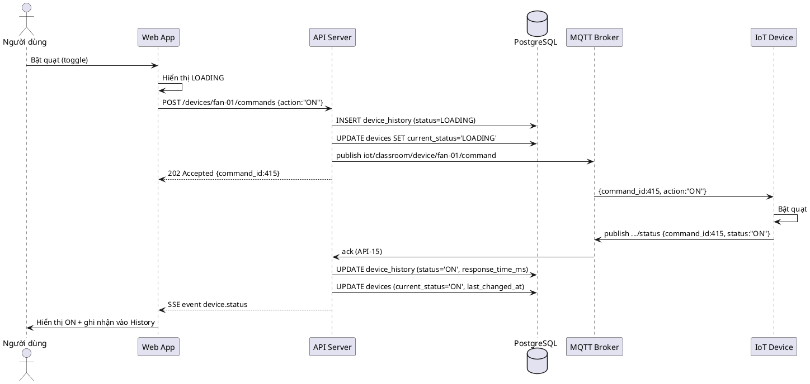

# TÀI LIỆU ĐẶC TẢ API

## HỆ THỐNG GIÁM SÁT NHIỆT ĐỘ, BẬT TẮT THIẾT BỊ PHÒNG HỌC

> Tài liệu này là phần đặc tả API đi kèm **SRS – Hệ thống giám sát nhiệt độ, bật tắt thiết bị phòng học** và **DATABASE – Thiết kế cơ sở dữ liệu** (PostgreSQL 16, database `classroom_iot`).
> Mọi trường dữ liệu trong tài liệu này đều tham chiếu trực tiếp tới các bảng `users`, `sensors`, `sensor_data`, `devices`, `device_history` trong `docs/schema.sql`.

---

# 4. THIẾT KẾ API

## 4.1. Danh sách API

**Base URL:** `http://localhost:8080/api/v1`
**Authentication:** JWT Bearer Token — truyền qua header `Authorization: Bearer <token>`
**Content-Type:** `application/json; charset=utf-8`
**Ngôn ngữ response:** Tiếng Anh (tên field), thông báo lỗi bằng Tiếng Việt
**Múi giờ:** Giờ Việt Nam UTC+7 — thời gian trả về theo ISO 8601 kèm offset (`2026-08-17T07:30:15+07:00`)

### 4.1.1. Bảng danh sách API

| #   | API ID | Method | Endpoint                            | Auth       | Mô tả ngắn                                |
| --: | ------ | ------ | ----------------------------------- | ---------- | ----------------------------------------- |
|   1 | API-01 | POST   | `/auth/login`                       | —          | Đăng nhập, lấy JWT token                  |
|   2 | API-02 | GET    | `/auth/me`                          | JWT        | Lấy thông tin phiên đăng nhập hiện tại    |
|   3 | API-03 | POST   | `/auth/logout`                      | JWT        | Đăng xuất, thu hồi token                  |
|   4 | API-04 | GET    | `/profile`                          | JWT        | Lấy thông tin profile + tài nguyên dự án  |
|   5 | API-05 | PUT    | `/profile`                          | JWT        | Cập nhật thông tin profile                |
|   6 | API-06 | GET    | `/sensors`                          | JWT        | Lấy danh mục cảm biến                     |
|   7 | API-07 | GET    | `/sensor-data`                      | JWT        | Lấy danh sách dữ liệu cảm biến (search/filter/sort/paging) |
|   8 | API-08 | GET    | `/sensor-data/latest`               | JWT        | Lấy giá trị mới nhất của từng cảm biến    |
|   9 | API-09 | GET    | `/sensor-data/series`               | JWT        | Lấy chuỗi dữ liệu vẽ biểu đồ              |
|  10 | API-10 | GET    | `/sensor-data/statistics`           | JWT        | Thống kê min/max/avg dữ liệu cảm biến     |
|  11 | API-11 | POST   | `/sensor-data`                      | Device Key | IoT Device gửi dữ liệu cảm biến lên       |
|  12 | API-12 | GET    | `/devices`                          | JWT        | Lấy danh sách thiết bị kèm trạng thái     |
|  13 | API-13 | GET    | `/devices/{device_code}`            | JWT        | Lấy chi tiết một thiết bị                 |
|  14 | API-14 | POST   | `/devices/{device_code}/commands`   | JWT        | Gửi lệnh bật/tắt thiết bị                 |
|  15 | API-15 | POST   | `/devices/{device_code}/ack`        | Device Key | IoT Device phản hồi trạng thái thực thi   |
|  16 | API-16 | GET    | `/device-history`                   | JWT        | Lấy lịch sử bật/tắt (search/filter/sort/paging) |
|  17 | API-17 | GET    | `/device-history/{id}`              | JWT        | Lấy chi tiết một bản ghi lịch sử          |
|  18 | API-18 | GET    | `/device-history/statistics`        | JWT        | Thống kê thao tác điều khiển              |
|  19 | API-19 | GET    | `/realtime/stream`                  | JWT        | Kênh SSE đẩy dữ liệu realtime lên Dashboard |

### 4.1.2. Cơ chế xác thực

| Tác nhân   | Cơ chế                       | Header                           | Ghi chú                                       |
| ---------- | ---------------------------- | -------------------------------- | --------------------------------------------- |
| User       | JWT Bearer Token             | `Authorization: Bearer <token>`  | Token nhận từ API-01, thời hạn 24 giờ (86400s) |
| IoT Device | API Key cố định của thiết bị | `X-Device-Key: <device_api_key>` | Dùng cho API-11 và API-15 (đánh dấu 🔌)       |

Mọi endpoint trừ API-01 đều **yêu cầu xác thực**. Thiếu/sai/hết hạn token → `401 UNAUTHORIZED`.

### 4.1.3. Cấu trúc phản hồi chung

**Thành công:**

```json
{
  "success": true,
  "data": {},
  "meta": null,
  "message": null
}
```

**Thành công có phân trang:**

```json
{
  "success": true,
  "data": [],
  "meta": {
    "page": 1,
    "page_size": 15,
    "total_items": 162,
    "total_pages": 11
  },
  "message": null
}
```

**Thất bại:**

```json
{
  "success": false,
  "data": null,
  "error": {
    "code": "VALIDATION_ERROR",
    "message": "Dữ liệu đầu vào không hợp lệ",
    "details": [{ "field": "username", "message": "Không được để trống" }]
  }
}
```

### 4.1.4. Mã trạng thái HTTP dùng chung

| Code | Ý nghĩa               | Trường hợp sử dụng                                       |
| ---- | --------------------- | -------------------------------------------------------- |
| 200  | OK                    | Truy vấn/cập nhật thành công                             |
| 201  | Created               | Tạo bản ghi mới (dữ liệu cảm biến)                       |
| 202  | Accepted              | Đã nhận lệnh điều khiển, đang chờ thiết bị phản hồi      |
| 400  | Bad Request           | Sai định dạng tham số, Max < Min, thời gian không hợp lệ  |
| 401  | Unauthorized          | Chưa đăng nhập, token/device key sai hoặc hết hạn        |
| 403  | Forbidden             | Không có quyền truy cập tài nguyên                       |
| 404  | Not Found             | Không tìm thấy thiết bị/cảm biến/bản ghi                 |
| 409  | Conflict              | Thiết bị đang `LOADING`, email/mã sinh viên đã tồn tại   |
| 422  | Unprocessable Entity  | Giá trị cảm biến ngoài ngưỡng `min_value`/`max_value`    |
| 500  | Internal Server Error | Lỗi hệ thống                                             |
| 503  | Service Unavailable   | Không kết nối được MQTT Broker / IoT Device offline      |
| 504  | Gateway Timeout       | Hết thời gian chờ phản hồi từ IoT Device                 |

### 4.1.5. Bảng mã lỗi nghiệp vụ

| Mã lỗi                      | HTTP | Thông báo hiển thị                                 | Nguồn (SRS)                |
| --------------------------- | ---- | -------------------------------------------------- | -------------------------- |
| `VALIDATION_ERROR`          | 400  | Vui lòng nhập đầy đủ thông tin                     | 2.6.1 – luồng 6a           |
| `INVALID_CREDENTIALS`       | 401  | Sai tên đăng nhập hoặc mật khẩu                    | 2.6.1 – luồng 7a, 7b       |
| `UNAUTHORIZED`              | 401  | Phiên đăng nhập đã hết hạn, vui lòng đăng nhập lại | 2.7.1.b                    |
| `INVALID_TIME_FORMAT`       | 400  | Định dạng thời gian không hợp lệ                   | 2.6.3 – luồng 3a           |
| `INVALID_RANGE`             | 400  | Giá trị Max không được nhỏ hơn Min                 | 2.7.3.b – mục 7            |
| `SENSOR_NOT_FOUND`          | 404  | Không tìm thấy cảm biến                            | DB 2.2 `sensors`           |
| `SENSOR_VALUE_OUT_OF_RANGE` | 422  | Giá trị cảm biến ngoài ngưỡng cho phép             | DB 2.2 `min/max_value`     |
| `DEVICE_NOT_FOUND`          | 404  | Không tìm thấy thiết bị                            | 2.6.2                      |
| `DEVICE_BUSY`               | 409  | Thiết bị đang xử lý lệnh trước đó                  | 2.6.2 – trạng thái LOADING |
| `COMMAND_SEND_FAILED`       | 503  | Thao tác không thành công                          | 2.6.2 – luồng 5a           |
| `DEVICE_TIMEOUT`            | 504  | Không thể xác nhận trạng thái thiết bị             | 2.6.2 – luồng 7a           |
| `RESOURCE_NOT_CONFIGURED`   | 404  | Tài nguyên chưa được cấu hình                      | 2.7.5.b – mục 8            |
| `CONFLICT`                  | 409  | Dữ liệu đã tồn tại trong hệ thống                  | DB 2.1 UNIQUE              |
| `INTERNAL_ERROR`            | 500  | Lỗi hệ thống, vui lòng thử lại                     | 2.6.1 – luồng 7c           |

### 4.1.6. Quy ước thời gian và tham số `search_time`

Tham số `search_time` hỗ trợ **thời gian rút gọn** theo mục 2.6.3 SRS; hệ thống tự quy đổi thành khoảng `[from, to)`:

| `search_time`         | from                  | to (không bao gồm)    | Phạm vi                  |
| --------------------- | --------------------- | --------------------- | ------------------------ |
| `2026`                | `2026-01-01 00:00:00` | `2027-01-01 00:00:00` | Cả năm 2026              |
| `2026/08`             | `2026-08-01 00:00:00` | `2026-09-01 00:00:00` | Cả tháng 08/2026         |
| `2026/08/17`          | `2026-08-17 00:00:00` | `2026-08-18 00:00:00` | Cả ngày 17/08/2026       |
| `2026/08/17 07`       | `2026-08-17 07:00:00` | `2026-08-17 08:00:00` | Từ 07:00:00 đến 07:59:59 |
| `2026/08/17 07:30`    | `2026-08-17 07:30:00` | `2026-08-17 07:31:00` | Từ 07:30:00 đến 07:30:59 |
| `2026/08/17 07:30:15` | `2026-08-17 07:30:15` | `2026-08-17 07:30:16` | Đúng giây tương ứng      |

Chuỗi không khớp các mẫu trên → `400 INVALID_TIME_FORMAT`. Việc **sắp xếp luôn dựa trên timestamp đầy đủ** lưu trong DB, không dựa trên chuỗi rút gọn.

### 4.1.7. Quy ước phân trang và sắp xếp

| Tham số     | Kiểu    | Mặc định | Ràng buộc                      | Mô tả                |
| ----------- | ------- | -------- | ------------------------------ | -------------------- |
| `page`      | integer | 1        | ≥ 1                            | Trang hiện tại       |
| `page_size` | integer | 15       | 1 – 100 (UI dùng 15 / 20 / 50) | Số bản ghi mỗi trang |
| `sort_by`   | string  | `time`   | Theo danh sách từng endpoint   | Trường sắp xếp       |
| `sort_dir`  | string  | `desc`   | `asc` \| `desc`                | Chiều sắp xếp        |

---

## 4.2. API-01 – Đăng nhập

| Thuộc tính  | Nội dung                                                                                          |
| ----------- | ------------------------------------------------------------------------------------------------- |
| **API ID**  | API-01                                                                                            |
| **Method**  | POST                                                                                              |
| **Endpoint**| `/auth/login`                                                                                     |
| **Mô tả**   | Xác thực người dùng bằng username/password. Trả về JWT token dùng cho toàn bộ request về sau       |
| **Auth**    | Không cần                                                                                         |
| **Use Case**| US01 – Đăng nhập                                                                                  |
| **DB**      | `users` (SELECT theo `LOWER(username)`, so khớp `password_hash` bằng bcrypt)                       |
| **MQTT**    | Không                                                                                             |

**Request Body:**

| Field      | Kiểu   | Bắt buộc | Điều kiện hợp lệ           | Ví dụ    |
| ---------- | ------ | -------- | -------------------------- | -------- |
| `username` | string | Có       | Không để trống, 4–50 ký tự | `admin`  |
| `password` | string | Có       | Không để trống, ≥ 6 ký tự  | `123456` |

```json
{
  "username": "admin",
  "password": "123456"
}
```

**Response Body (200 OK):**

```json
{
  "success": true,
  "data": {
    "access_token": "eyJhbGciOiJIUzI1NiIsInR5cCI6IkpXVCJ9...",
    "token_type": "Bearer",
    "expires_in": 86400,
    "user": {
      "id": 1,
      "username": "admin",
      "full_name": "Anh Tran",
      "student_id": "B21DCCN001",
      "class_name": "D21CQCN01-B",
      "email": "anhtran@student.ptit.edu.vn",
      "avatar_url": "/avatars/shadcn.jpg"
    }
  }
}
```

**HTTP Status:**

| Code | Ý nghĩa                                       |
| ---- | --------------------------------------------- |
| 200  | Đăng nhập thành công                          |
| 400  | Thiếu `username` hoặc `password`              |
| 401  | Tài khoản không tồn tại hoặc sai mật khẩu     |
| 500  | Lỗi hệ thống khi xác thực                     |

**Error Response (401):**

```json
{
  "success": false,
  "data": null,
  "error": {
    "code": "INVALID_CREDENTIALS",
    "message": "Sai tên đăng nhập hoặc mật khẩu"
  }
}
```

> Không phân biệt "tài khoản không tồn tại" và "sai mật khẩu" trong thông báo trả về (mục 2.6.1 SRS). Trường `password_hash` **không bao giờ** xuất hiện trong response.

---

## 4.3. API-02 – Lấy thông tin phiên đăng nhập

| Thuộc tính  | Nội dung                                                                     |
| ----------- | ---------------------------------------------------------------------------- |
| **API ID**  | API-02                                                                       |
| **Method**  | GET                                                                          |
| **Endpoint**| `/auth/me`                                                                   |
| **Mô tả**   | Lấy thông tin người dùng của token hiện tại, dùng để khôi phục phiên khi tải lại trang |
| **Auth**    | Có — Bearer Token                                                            |
| **Use Case**| US01 – Đăng nhập                                                             |
| **DB**      | `users` (SELECT theo `id` trong payload token)                               |
| **MQTT**    | Không                                                                        |

**Request Header:**

```http
Authorization: Bearer <token>
```

**Response Body (200 OK):**

```json
{
  "success": true,
  "data": {
    "id": 1,
    "username": "admin",
    "full_name": "Anh Tran",
    "student_id": "B21DCCN001",
    "class_name": "D21CQCN01-B",
    "email": "anhtran@student.ptit.edu.vn",
    "avatar_url": "/avatars/shadcn.jpg",
    "token_expires_at": "2026-08-18T07:30:15+07:00"
  }
}
```

**HTTP Status:**

| Code | Ý nghĩa                                |
| ---- | -------------------------------------- |
| 200  | Thành công                             |
| 401  | Token không hợp lệ hoặc đã hết hạn     |
| 500  | Lỗi hệ thống                           |

**Error Response (401):**

```json
{
  "success": false,
  "data": null,
  "error": {
    "code": "UNAUTHORIZED",
    "message": "Phiên đăng nhập đã hết hạn, vui lòng đăng nhập lại"
  }
}
```

---

## 4.4. API-03 – Đăng xuất

| Thuộc tính  | Nội dung                                                                       |
| ----------- | ------------------------------------------------------------------------------ |
| **API ID**  | API-03                                                                         |
| **Method**  | POST                                                                           |
| **Endpoint**| `/auth/logout`                                                                 |
| **Mô tả**   | Thu hồi token hiện tại (đưa vào blacklist tới khi hết hạn); FE xóa token khỏi storage |
| **Auth**    | Có — Bearer Token                                                              |
| **Use Case**| US01 – Đăng nhập                                                               |
| **DB**      | Không (token blacklist lưu ở cache/bộ nhớ server)                              |
| **MQTT**    | Không                                                                          |

**Request Header:**

```http
Authorization: Bearer <token>
```

**Request Body:** Không có

**Response Body (200 OK):**

```json
{
  "success": true,
  "data": null,
  "message": "Đã đăng xuất"
}
```

**HTTP Status:**

| Code | Ý nghĩa                            |
| ---- | ---------------------------------- |
| 200  | Đăng xuất thành công               |
| 401  | Token không hợp lệ hoặc đã hết hạn |
| 500  | Lỗi hệ thống                       |

---

## 4.5. API-04 – Lấy thông tin Profile

| Thuộc tính  | Nội dung                                                                                    |
| ----------- | ------------------------------------------------------------------------------------------- |
| **API ID**  | API-04                                                                                      |
| **Method**  | GET                                                                                         |
| **Endpoint**| `/profile`                                                                                  |
| **Mô tả**   | Lấy hồ sơ của người dùng đang đăng nhập: ảnh đại diện, họ tên, mã sinh viên, lớp, email và 4 liên kết tài nguyên dự án |
| **Auth**    | Có — Bearer Token                                                                           |
| **Use Case**| US05 – Profile                                                                              |
| **DB**      | `users` (SELECT `full_name`, `student_id`, `class_name`, `email`, `avatar_url`, `github_url`, `figma_url`, `postman_url`, `report_url`) |
| **MQTT**    | Không                                                                                       |

**Request Parameters:** Không có

**Response Body (200 OK):**

```json
{
  "success": true,
  "data": {
    "id": 1,
    "username": "admin",
    "full_name": "Anh Tran",
    "student_id": "B21DCCN001",
    "class_name": "D21CQCN01-B",
    "email": "anhtran@student.ptit.edu.vn",
    "avatar_url": "/avatars/shadcn.jpg",
    "created_at": "2026-08-01T08:00:00+07:00",
    "project_links": [
      { "type": "github",  "label": "GitHub",  "description": "Repository mã nguồn dự án",       "url": "https://github.com/" },
      { "type": "figma",   "label": "Figma",   "description": "Thiết kế giao diện hệ thống",     "url": "https://figma.com/" },
      { "type": "postman", "label": "Postman", "description": "Tài liệu API và collection test", "url": null },
      { "type": "report",  "label": "Báo cáo", "description": "Tài liệu báo cáo bài tập lớn",    "url": null }
    ]
  }
}
```

**HTTP Status:**

| Code | Ý nghĩa                    |
| ---- | -------------------------- |
| 200  | Thành công                 |
| 401  | Chưa xác thực              |
| 404  | Không tìm thấy người dùng  |
| 500  | Lỗi hệ thống               |

**Error Response (404) — khi người dùng chọn một liên kết chưa được cấu hình:**

```json
{
  "success": false,
  "data": null,
  "error": {
    "code": "RESOURCE_NOT_CONFIGURED",
    "message": "Tài nguyên chưa được cấu hình"
  }
}
```

> `url = null` ứng với tài nguyên chưa cấu hình; giao diện hiển thị trạng thái "chưa được cấu hình" và **không chuyển hướng** (mục 2.7.5.b SRS).

---

## 4.6. API-05 – Cập nhật Profile

| Thuộc tính  | Nội dung                                                                          |
| ----------- | --------------------------------------------------------------------------------- |
| **API ID**  | API-05                                                                            |
| **Method**  | PUT                                                                               |
| **Endpoint**| `/profile`                                                                        |
| **Mô tả**   | Cập nhật hồ sơ của người dùng đang đăng nhập. Chỉ cập nhật các field được gửi lên  |
| **Auth**    | Có — Bearer Token                                                                 |
| **Use Case**| US05 – Profile                                                                    |
| **DB**      | `users` (UPDATE; trigger `trg_users_updated_at` tự cập nhật `updated_at`)          |
| **MQTT**    | Không                                                                             |

**Request Body:** (mọi field tùy chọn)

| Field         | Kiểu   | Bắt buộc | Điều kiện hợp lệ                                | Ví dụ                         |
| ------------- | ------ | -------- | ----------------------------------------------- | ----------------------------- |
| `full_name`   | string | Không    | 1–100 ký tự                                     | `Anh Tran`                    |
| `student_id`  | string | Không    | ≤ 20 ký tự, không trùng (`uq_student_id`)       | `B21DCCN001`                  |
| `class_name`  | string | Không    | ≤ 50 ký tự                                      | `D21CQCN01-B`                 |
| `email`       | string | Không    | Email hợp lệ, ≤ 100 ký tự, không trùng (`uq_email_lower`) | `anhtran@student.ptit.edu.vn` |
| `avatar_url`  | string | Không    | URL hoặc đường dẫn tương đối, ≤ 500 ký tự       | `/avatars/shadcn.jpg`         |
| `github_url`  | string | Không    | URL `http/https` hoặc `null`, ≤ 500 ký tự       | `https://github.com/`         |
| `figma_url`   | string | Không    | URL `http/https` hoặc `null`, ≤ 500 ký tự       | `https://figma.com/`          |
| `postman_url` | string | Không    | URL `http/https` hoặc `null`, ≤ 500 ký tự       | `null`                        |
| `report_url`  | string | Không    | URL `http/https` hoặc `null`, ≤ 500 ký tự       | `null`                        |

```json
{
  "full_name": "Anh Tran",
  "student_id": "B21DCCN001",
  "class_name": "D21CQCN01-B",
  "email": "anhtran@student.ptit.edu.vn",
  "github_url": "https://github.com/anhtran/btl-iot",
  "figma_url": "https://figma.com/file/xxx",
  "postman_url": null,
  "report_url": null
}
```

**Response Body (200 OK):**

```json
{
  "success": true,
  "data": { "...profile đầy đủ như API-04..." },
  "message": "Cập nhật thông tin thành công"
}
```

**HTTP Status:**

| Code | Ý nghĩa                                        |
| ---- | ---------------------------------------------- |
| 200  | Cập nhật thành công                            |
| 400  | Dữ liệu không hợp lệ (email sai format, URL sai) |
| 401  | Chưa xác thực                                  |
| 409  | Email hoặc mã sinh viên đã tồn tại             |
| 500  | Lỗi hệ thống                                   |

**Error Response (409):**

```json
{
  "success": false,
  "data": null,
  "error": {
    "code": "CONFLICT",
    "message": "Email đã tồn tại trong hệ thống",
    "details": [{ "field": "email", "message": "Email đã được sử dụng" }]
  }
}
```

---

## 4.7. API-06 – Lấy danh mục cảm biến

| Thuộc tính  | Nội dung                                                                              |
| ----------- | ------------------------------------------------------------------------------------- |
| **API ID**  | API-06                                                                                |
| **Method**  | GET                                                                                   |
| **Endpoint**| `/sensors`                                                                            |
| **Mô tả**   | Lấy danh mục cảm biến trong hệ thống, dùng để đổ dữ liệu cho bộ lọc cảm biến của màn hình Data Sensor và tiêu đề các thẻ trên Dashboard |
| **Auth**    | Có — Bearer Token                                                                     |
| **Use Case**| US02 – Dashboard, US03 – Data Sensor                                                  |
| **DB**      | `sensors` (SELECT)                                                                    |
| **MQTT**    | Không                                                                                 |

**Query Parameters:**

| Param       | Kiểu    | Bắt buộc | Mặc định | Mô tả                              |
| ----------- | ------- | -------- | -------- | ---------------------------------- |
| `is_active` | boolean | Không    | `true`   | Chỉ lấy cảm biến đang được sử dụng |

**Ví dụ request:**

```http
GET /api/v1/sensors?is_active=true
Authorization: Bearer <token>
```

**Response Body (200 OK):**

```json
{
  "success": true,
  "data": [
    { "id": 1, "sensor_code": "temperature", "sensor_name": "Cảm biến nhiệt độ", "unit": "°C",  "min_value": -10, "max_value": 80,     "is_active": true },
    { "id": 2, "sensor_code": "light",       "sensor_name": "Cảm biến ánh sáng", "unit": "lux", "min_value": 0,   "max_value": 100000, "is_active": true },
    { "id": 3, "sensor_code": "humidity",    "sensor_name": "Cảm biến độ ẩm",    "unit": "%",   "min_value": 0,   "max_value": 100,    "is_active": true }
  ]
}
```

**HTTP Status:**

| Code | Ý nghĩa       |
| ---- | ------------- |
| 200  | Thành công    |
| 401  | Chưa xác thực |
| 500  | Lỗi hệ thống  |

---

## 4.8. API-07 – Lấy danh sách dữ liệu cảm biến (search / filter / sort / paging)

| Thuộc tính  | Nội dung                                                                                     |
| ----------- | -------------------------------------------------------------------------------------------- |
| **API ID**  | API-07                                                                                       |
| **Method**  | GET                                                                                          |
| **Endpoint**| `/sensor-data`                                                                               |
| **Mô tả**   | Lấy danh sách bản ghi dữ liệu cảm biến cho bảng Data Sensor. Hỗ trợ tìm kiếm theo thời gian rút gọn, lọc theo cảm biến và khoảng giá trị, sắp xếp và phân trang |
| **Auth**    | Có — Bearer Token                                                                            |
| **Use Case**| US03 – Data Sensor                                                                           |
| **DB**      | `sensor_data` JOIN `sensors` (dùng index `idx_sensor_recorded`, `idx_recorded_at`, `idx_sensor_value`) |
| **MQTT**    | Không                                                                                        |

**Query Parameters:**

| Param                                 | Kiểu    | Bắt buộc | Mặc định | Điều kiện hợp lệ                                                       | Ví dụ                       |
| ------------------------------------- | ------- | -------- | -------- | ---------------------------------------------------------------------- | --------------------------- |
| `search_time`                         | string  | Không    | —        | Theo bảng mục 4.1.6                                                    | `2026/08/17 07`             |
| `from`                                | string  | Không    | —        | ISO 8601, dùng khi cần khoảng thời gian tùy ý                          | `2026-08-17T00:00:00+07:00` |
| `to`                                  | string  | Không    | —        | ISO 8601, phải ≥ `from`                                                | `2026-08-18T00:00:00+07:00` |
| `sensor`                              | string  | Không    | tất cả   | `temperature` \| `light` \| `humidity`; nhiều giá trị cách nhau dấu phẩy | `temperature,light`         |
| `value_min`                           | number  | Không    | —        | Số thực, áp dụng khi chỉ chọn 1 cảm biến                               | `25`                        |
| `value_max`                           | number  | Không    | —        | Số thực, ≥ `value_min`                                                 | `30`                        |
| `temperature_min` / `temperature_max` | number  | Không    | —        | Chỉ lọc bản ghi của cảm biến nhiệt độ                                  | `25` / `30`                 |
| `light_min` / `light_max`             | number  | Không    | —        | Chỉ lọc bản ghi của cảm biến ánh sáng                                  | `300` / `700`               |
| `humidity_min` / `humidity_max`       | number  | Không    | —        | Chỉ lọc bản ghi của cảm biến độ ẩm                                     | `40` / `80`                 |
| `sort_by`                             | string  | Không    | `time`   | `id` \| `sensor_name` \| `value` \| `time`                             | `time`                      |
| `sort_dir`                            | string  | Không    | `desc`   | `asc` \| `desc`                                                        | `desc`                      |
| `page`                                | integer | Không    | 1        | ≥ 1                                                                    | `1`                         |
| `page_size`                           | integer | Không    | 15       | 1 – 100                                                                | `15`                        |

**Ngữ nghĩa `<sensor>_min` / `<sensor>_max`:** mỗi cặp chỉ áp dụng lên bản ghi **thuộc đúng cảm biến đó**; bản ghi của cảm biến không được nêu tham số sẽ không bị lọc theo giá trị. Nhờ vậy có thể kết hợp "nhiệt độ 25–30 °C" và "ánh sáng 300–700 lux" trong cùng một truy vấn (mục 2.6.3 SRS). Các điều kiện lọc kết hợp theo **AND**, nhiều giá trị trong cùng một tham số kết hợp theo **OR**.

**Ví dụ request:**

```http
GET /api/v1/sensor-data?search_time=2026/08/17%2007&sensor=temperature,light&temperature_min=25&temperature_max=30&sort_by=time&sort_dir=desc&page=1&page_size=15
Authorization: Bearer <token>
```

**Response Body (200 OK):**

```json
{
  "success": true,
  "data": [
    {
      "id": 162,
      "sensor_id": 2,
      "sensor_code": "light",
      "sensor_name": "Cảm biến ánh sáng",
      "value": 648,
      "unit": "lux",
      "time": "2026-08-17T07:59:43+07:00"
    },
    {
      "id": 161,
      "sensor_id": 1,
      "sensor_code": "temperature",
      "sensor_name": "Cảm biến nhiệt độ",
      "value": 28.5,
      "unit": "°C",
      "time": "2026-08-17T07:59:40+07:00"
    }
  ],
  "meta": { "page": 1, "page_size": 15, "total_items": 162, "total_pages": 11 }
}
```

**HTTP Status:**

| Code | Ý nghĩa                                                 |
| ---- | ------------------------------------------------------- |
| 200  | Thành công (có thể trả về `data = []`)                   |
| 400  | `search_time`/`from`/`to` sai định dạng, hoặc Max < Min  |
| 401  | Chưa xác thực                                           |
| 404  | `sensor` không tồn tại trong danh mục                   |
| 500  | Lỗi hệ thống                                            |

**Error Response (400):**

```json
{
  "success": false,
  "data": null,
  "error": {
    "code": "INVALID_TIME_FORMAT",
    "message": "Định dạng thời gian không hợp lệ",
    "details": [
      {
        "field": "search_time",
        "message": "Hỗ trợ các dạng: 2026, 2026/08, 2026/08/17, 2026/08/17 07, 2026/08/17 07:30, 2026/08/17 07:30:15"
      }
    ]
  }
}
```

> Không có bản ghi phù hợp **không phải lỗi**: trả `200` với `data = []`, giao diện hiển thị "Không có dữ liệu phù hợp" (luồng thay thế 5a mục 2.6.3 SRS).

---

## 4.9. API-08 – Lấy giá trị cảm biến mới nhất

| Thuộc tính  | Nội dung                                                                                  |
| ----------- | ----------------------------------------------------------------------------------------- |
| **API ID**  | API-08                                                                                    |
| **Method**  | GET                                                                                       |
| **Endpoint**| `/sensor-data/latest`                                                                     |
| **Mô tả**   | Lấy bản ghi mới nhất của từng cảm biến (nhiệt độ, ánh sáng, độ ẩm) cho các thẻ dữ liệu thời gian thực trên Dashboard |
| **Auth**    | Có — Bearer Token                                                                         |
| **Use Case**| US02 – Dashboard                                                                          |
| **DB**      | `sensor_data` JOIN `sensors` (lấy `recorded_at` lớn nhất theo từng `sensor_id`)            |
| **MQTT**    | Không (dữ liệu đã được API-11 ghi vào DB từ topic cảm biến)                               |

**Request Parameters:** Không có

**Response Body (200 OK):**

```json
{
  "success": true,
  "data": {
    "temperature": { "sensor_id": 1, "value": 28.5, "unit": "°C",  "time": "2026-08-17T07:59:40+07:00" },
    "light":       { "sensor_id": 2, "value": 648,  "unit": "lux", "time": "2026-08-17T07:59:43+07:00" },
    "humidity":    { "sensor_id": 3, "value": 61.5, "unit": "%",   "time": "2026-08-17T07:59:46+07:00" },
    "device_online": true,
    "last_seen_at": "2026-08-17T07:59:46+07:00"
  }
}
```

**Response Body (200 OK) — khi chưa có dữ liệu:**

```json
{
  "success": true,
  "data": {
    "temperature": null,
    "light": null,
    "humidity": null,
    "device_online": false,
    "last_seen_at": null
  }
}
```

**HTTP Status:**

| Code | Ý nghĩa                                        |
| ---- | ---------------------------------------------- |
| 200  | Thành công (cảm biến chưa có dữ liệu → `null`) |
| 401  | Chưa xác thực                                  |
| 500  | Lỗi hệ thống                                   |

> Cảm biến chưa có bản ghi nào → giá trị `null`; giao diện hiển thị "Chưa có dữ liệu" và **không sinh dữ liệu cảm biến giả** (luồng thay thế 3a, 3b mục 2.6.2 SRS). `device_online = false` khi không nhận được dữ liệu trong 60 giây gần nhất.

---

## 4.10. API-09 – Lấy dữ liệu biểu đồ

| Thuộc tính  | Nội dung                                                                                  |
| ----------- | ----------------------------------------------------------------------------------------- |
| **API ID**  | API-09                                                                                    |
| **Method**  | GET                                                                                       |
| **Endpoint**| `/sensor-data/series`                                                                     |
| **Mô tả**   | Lấy chuỗi dữ liệu lịch sử đã gộp theo bước thời gian để vẽ biểu đồ biến động nhiệt độ và ánh sáng trên Dashboard |
| **Auth**    | Có — Bearer Token                                                                         |
| **Use Case**| US02 – Dashboard (Xem biểu đồ cảm biến)                                                   |
| **DB**      | `sensor_data` JOIN `sensors` (GROUP BY bước thời gian, AVG(`value`))                      |
| **MQTT**    | Không                                                                                     |

**Query Parameters:**

| Param      | Kiểu    | Bắt buộc | Mặc định | Điều kiện hợp lệ                               | Ví dụ                       |
| ---------- | ------- | -------- | -------- | ---------------------------------------------- | --------------------------- |
| `range`    | string  | Không    | `2h`     | `15m` \| `1h` \| `2h` \| `6h` \| `24h` \| `7d` | `2h`                        |
| `from`     | string  | Không    | —        | ISO 8601, dùng thay cho `range`                | `2026-08-17T06:00:00+07:00` |
| `to`       | string  | Không    | —        | ISO 8601, phải ≥ `from`                        | `2026-08-17T08:00:00+07:00` |
| `interval` | string  | Không    | `5m`     | `20s` \| `1m` \| `5m` \| `15m` \| `1h`         | `5m`                        |
| `sensor`   | string  | Không    | tất cả   | Danh sách `sensor_code` cách nhau dấu phẩy     | `temperature,light`         |
| `limit`    | integer | Không    | 100      | 1 – 500                                        | `100`                       |

**Ví dụ request:**

```http
GET /api/v1/sensor-data/series?range=2h&interval=5m&sensor=temperature,light
Authorization: Bearer <token>
```

**Response Body (200 OK):**

```json
{
  "success": true,
  "data": [
    { "time": "2026-08-17T07:00:00+07:00", "temperature": 26.4, "light": 480, "humidity": 58 },
    { "time": "2026-08-17T07:05:00+07:00", "temperature": 26.9, "light": 502, "humidity": 59 },
    { "time": "2026-08-17T07:10:00+07:00", "temperature": 27.3, "light": 534, "humidity": 59.5 }
  ],
  "meta": { "range": "2h", "interval": "5m", "points": 24 }
}
```

**HTTP Status:**

| Code | Ý nghĩa                                                 |
| ---- | ------------------------------------------------------- |
| 200  | Thành công                                              |
| 400  | `range`/`interval` không thuộc danh sách, `to` < `from`  |
| 401  | Chưa xác thực                                           |
| 404  | `sensor` không tồn tại                                  |
| 500  | Lỗi hệ thống                                            |

**Error Response (400):**

```json
{
  "success": false,
  "data": null,
  "error": {
    "code": "INVALID_RANGE",
    "message": "Khoảng thời gian không hợp lệ",
    "details": [
      { "field": "to", "message": "Thời gian kết thúc phải lớn hơn hoặc bằng thời gian bắt đầu" }
    ]
  }
}
```

---

## 4.11. API-10 – Thống kê dữ liệu cảm biến

| Thuộc tính  | Nội dung                                                                             |
| ----------- | ------------------------------------------------------------------------------------ |
| **API ID**  | API-10                                                                               |
| **Method**  | GET                                                                                  |
| **Endpoint**| `/sensor-data/statistics`                                                            |
| **Mô tả**   | Thống kê số bản ghi, giá trị nhỏ nhất/lớn nhất/trung bình và giá trị mới nhất của từng cảm biến theo cùng bộ lọc của API-07 |
| **Auth**    | Có — Bearer Token                                                                    |
| **Use Case**| US03 – Data Sensor                                                                   |
| **DB**      | `sensor_data` JOIN `sensors` (COUNT, MIN, MAX, AVG theo `sensor_id`)                  |
| **MQTT**    | Không                                                                                |

**Query Parameters:** dùng chung bộ lọc của API-07 — `search_time`, `from`, `to`, `sensor`, các cặp `<sensor>_min` / `<sensor>_max`.

**Ví dụ request:**

```http
GET /api/v1/sensor-data/statistics?search_time=2026/08/17&sensor=temperature,light
Authorization: Bearer <token>
```

**Response Body (200 OK):**

```json
{
  "success": true,
  "data": [
    { "sensor_id": 1, "sensor_code": "temperature", "sensor_name": "Cảm biến nhiệt độ", "unit": "°C",  "count": 54, "min": 25.3, "max": 30.1, "avg": 27.8,  "latest": 28.5 },
    { "sensor_id": 2, "sensor_code": "light",       "sensor_name": "Cảm biến ánh sáng", "unit": "lux", "count": 54, "min": 312,  "max": 698,  "avg": 521.4, "latest": 648 }
  ]
}
```

**HTTP Status:**

| Code | Ý nghĩa                                                         |
| ---- | --------------------------------------------------------------- |
| 200  | Thành công (không có dữ liệu → `count = 0`, các giá trị `null`)  |
| 400  | Tham số lọc không hợp lệ                                        |
| 401  | Chưa xác thực                                                   |
| 500  | Lỗi hệ thống                                                    |

---

## 4.12. API-11 🔌 – IoT Device gửi dữ liệu cảm biến

| Thuộc tính  | Nội dung                                                                                        |
| ----------- | ----------------------------------------------------------------------------------------------- |
| **API ID**  | API-11                                                                                          |
| **Method**  | POST                                                                                            |
| **Endpoint**| `/sensor-data`                                                                                  |
| **Mô tả**   | IoT Device gửi các giá trị cảm biến đọc được lên hệ thống. Server ghi vào DB rồi phát sự kiện realtime `sensor.reading` tới Dashboard. Đồng thời là handler cho message MQTT topic cảm biến |
| **Auth**    | Có — Device API Key (`X-Device-Key`)                                                            |
| **Use Case**| US02 – Dashboard (luồng IoT Device gửi dữ liệu, bước 3–4)                                        |
| **DB**      | `sensor_data` (INSERT), `sensors` (kiểm tra `sensor_code` và ngưỡng `min_value`/`max_value`)     |
| **MQTT**    | Subscribe topic `iot/classroom/sensor` (QoS 0)                                                  |

**Request Header:**

```http
X-Device-Key: <device_api_key>
```

**Request Body:**

| Field                    | Kiểu   | Bắt buộc | Điều kiện hợp lệ                                | Ví dụ                       |
| ------------------------ | ------ | -------- | ----------------------------------------------- | --------------------------- |
| `recorded_at`            | string | Không    | ISO 8601; bỏ trống thì lấy thời điểm server nhận | `2026-08-17T07:59:40+07:00` |
| `readings`               | array  | Có       | 1 – 20 phần tử                                  | —                           |
| `readings[].sensor_code` | string | Có       | Tồn tại trong `sensors.sensor_code`             | `temperature`               |
| `readings[].value`       | number | Có       | Số thực, trong khoảng `[min_value, max_value]`  | `28.5`                      |

```json
{
  "recorded_at": "2026-08-17T07:59:40+07:00",
  "readings": [
    { "sensor_code": "temperature", "value": 28.5 },
    { "sensor_code": "light",       "value": 648 },
    { "sensor_code": "humidity",    "value": 61.5 }
  ]
}
```

**Response Body (201 Created):**

```json
{
  "success": true,
  "data": {
    "inserted": 3,
    "ids": [161, 162, 163],
    "recorded_at": "2026-08-17T07:59:40+07:00"
  },
  "message": "Đã ghi nhận dữ liệu cảm biến"
}
```

**HTTP Status:**

| Code | Ý nghĩa                                                        |
| ---- | -------------------------------------------------------------- |
| 201  | Đã ghi nhận dữ liệu thành công                                 |
| 400  | Payload không hợp lệ (thiếu `readings`, `value` không phải số) |
| 401  | Device key sai hoặc thiếu                                      |
| 404  | `sensor_code` không tồn tại trong danh mục                     |
| 422  | Giá trị ngoài ngưỡng `min_value`/`max_value` của cảm biến      |
| 500  | Lỗi hệ thống                                                   |

**Error Response (422):**

```json
{
  "success": false,
  "data": null,
  "error": {
    "code": "SENSOR_VALUE_OUT_OF_RANGE",
    "message": "Giá trị cảm biến ngoài ngưỡng cho phép",
    "details": [
      { "field": "readings[0].value", "message": "Nhiệt độ phải nằm trong khoảng -10 đến 80 °C" }
    ]
  }
}
```

---

## 4.13. API-12 – Lấy danh sách thiết bị

| Thuộc tính  | Nội dung                                                                                     |
| ----------- | -------------------------------------------------------------------------------------------- |
| **API ID**  | API-12                                                                                       |
| **Method**  | GET                                                                                          |
| **Endpoint**| `/devices`                                                                                   |
| **Mô tả**   | Lấy danh sách thiết bị điều khiển (quạt, đèn) kèm trạng thái hiện tại để hiển thị khu vực điều khiển trên Dashboard và đổ dữ liệu cho bộ lọc Device của History |
| **Auth**    | Có — Bearer Token                                                                            |
| **Use Case**| US02 – Dashboard, US04 – History                                                             |
| **DB**      | `devices` (SELECT `current_status`, `last_changed_at`; index `idx_device_type`)               |
| **MQTT**    | Không                                                                                        |

**Query Parameters:**

| Param         | Kiểu   | Bắt buộc | Mặc định | Điều kiện hợp lệ                        | Ví dụ   |
| ------------- | ------ | -------- | -------- | --------------------------------------- | ------- |
| `device_type` | string | Không    | tất cả   | `FAN` \| `LIGHT`                        | `FAN`   |
| `status`      | string | Không    | tất cả   | `ON` \| `OFF` \| `LOADING`              | `ON`    |

**Ví dụ request:**

```http
GET /api/v1/devices?device_type=FAN
Authorization: Bearer <token>
```

**Response Body (200 OK):**

```json
{
  "success": true,
  "data": [
    {
      "id": 1,
      "device_code": "fan-01",
      "device_name": "Quạt 1",
      "device_type": "FAN",
      "location": "Dãy trái",
      "description": "Làm mát khu vực dãy trái",
      "status": "OFF",
      "last_changed_at": "2026-08-17T07:42:11+07:00"
    },
    {
      "id": 2,
      "device_code": "fan-02",
      "device_name": "Quạt 2",
      "device_type": "FAN",
      "location": "Dãy phải",
      "description": "Làm mát khu vực dãy phải",
      "status": "ON",
      "last_changed_at": "2026-08-17T07:50:35+07:00"
    },
    {
      "id": 3,
      "device_code": "light-board",
      "device_name": "Đèn bảng",
      "device_type": "LIGHT",
      "location": "Khu vực bảng",
      "description": "Chiếu sáng khu vực bảng",
      "status": "LOADING",
      "last_changed_at": "2026-08-17T07:15:03+07:00"
    }
  ]
}
```

**HTTP Status:**

| Code | Ý nghĩa                                              |
| ---- | ---------------------------------------------------- |
| 200  | Thành công                                           |
| 400  | `device_type`/`status` không thuộc danh sách ENUM     |
| 401  | Chưa xác thực                                        |
| 500  | Lỗi hệ thống                                         |

---

## 4.14. API-13 – Lấy chi tiết một thiết bị

| Thuộc tính  | Nội dung                                                                            |
| ----------- | ----------------------------------------------------------------------------------- |
| **API ID**  | API-13                                                                              |
| **Method**  | GET                                                                                 |
| **Endpoint**| `/devices/{device_code}`                                                            |
| **Mô tả**   | Lấy chi tiết một thiết bị kèm bản ghi lệnh gần nhất, dùng khi cần đối chiếu trạng thái |
| **Auth**    | Có — Bearer Token                                                                   |
| **Use Case**| US02 – Dashboard                                                                    |
| **DB**      | `devices` JOIN `device_history` (bản ghi `requested_at` mới nhất)                    |
| **MQTT**    | Không                                                                               |

**Path Parameters:**

| Param         | Kiểu   | Mô tả                                          |
| ------------- | ------ | ---------------------------------------------- |
| `device_code` | string | Mã thiết bị, ví dụ `fan-01`, `light-board`     |

**Response Body (200 OK):**

```json
{
  "success": true,
  "data": {
    "id": 1,
    "device_code": "fan-01",
    "device_name": "Quạt 1",
    "device_type": "FAN",
    "location": "Dãy trái",
    "description": "Làm mát khu vực dãy trái",
    "status": "ON",
    "last_changed_at": "2026-08-17T08:01:21+07:00",
    "last_command": {
      "id": 415,
      "action": "ON",
      "status": "ON",
      "requested_at": "2026-08-17T08:01:20+07:00",
      "responded_at": "2026-08-17T08:01:21+07:00",
      "response_time_ms": 1240
    }
  }
}
```

**HTTP Status:**

| Code | Ý nghĩa                          |
| ---- | -------------------------------- |
| 200  | Thành công                       |
| 401  | Chưa xác thực                    |
| 404  | Không tìm thấy thiết bị          |
| 500  | Lỗi hệ thống                     |

**Error Response (404):**

```json
{
  "success": false,
  "data": null,
  "error": {
    "code": "DEVICE_NOT_FOUND",
    "message": "Không tìm thấy thiết bị"
  }
}
```

---

## 4.15. API-14 – Gửi lệnh bật/tắt thiết bị

| Thuộc tính  | Nội dung                                                                                                        |
| ----------- | --------------------------------------------------------------------------------------------------------------- |
| **API ID**  | API-14                                                                                                          |
| **Method**  | POST                                                                                                            |
| **Endpoint**| `/devices/{device_code}/commands`                                                                               |
| **Mô tả**   | Người dùng bật/tắt thiết bị trên Dashboard. Hệ thống tạo bản ghi `device_history` với `status = LOADING`, đặt `devices.current_status = LOADING`, rồi publish lệnh xuống IoT Device qua MQTT |
| **Auth**    | Có — Bearer Token                                                                                               |
| **Use Case**| US02 – Dashboard (Điều khiển thiết bị, bước 3–5)                                                                |
| **DB**      | `device_history` (INSERT `action`, `status = LOADING`, `user_id`, `requested_at`), `devices` (UPDATE `current_status`) |
| **MQTT**    | Publish topic `iot/classroom/device/{device_code}/command` (QoS 1) — payload `{"command_id":415,"action":"ON"}`  |

**Path Parameters:**

| Param         | Kiểu   | Mô tả                                      |
| ------------- | ------ | ------------------------------------------ |
| `device_code` | string | Mã thiết bị cần điều khiển, ví dụ `fan-01` |

**Request Body:**

| Field    | Kiểu   | Bắt buộc | Điều kiện hợp lệ | Mô tả                |
| -------- | ------ | -------- | ---------------- | -------------------- |
| `action` | string | Có       | `ON` \| `OFF`    | Hành động điều khiển |

```json
{
  "action": "ON"
}
```

**Response Body (202 Accepted):**

```json
{
  "success": true,
  "data": {
    "command_id": 415,
    "device_id": 1,
    "device_code": "fan-01",
    "device_name": "Quạt 1",
    "action": "ON",
    "status": "LOADING",
    "requested_at": "2026-08-17T08:01:20+07:00",
    "timeout_ms": 10000
  },
  "message": "Đã gửi lệnh, đang chờ thiết bị phản hồi"
}
```

- `command_id` chính là `device_history.id`; client dùng nó để theo dõi kết quả qua API-19 (realtime) hoặc API-17.
- Trong lúc chờ, giao diện hiển thị trạng thái `LOADING` (bước 4 mục 2.6.2 SRS).

**HTTP Status:**

| Code | Ý nghĩa                                                                          |
| ---- | -------------------------------------------------------------------------------- |
| 202  | Lệnh đã được gửi, đang chờ thiết bị phản hồi                                     |
| 400  | `action` không phải `ON`/`OFF`                                                    |
| 401  | Chưa xác thực                                                                    |
| 404  | Không tìm thấy thiết bị                                                          |
| 409  | Thiết bị đang `LOADING` do lệnh trước chưa hoàn tất                              |
| 503  | Không gửi được lệnh (MQTT Broker lỗi) — bản ghi lịch sử được đánh `FAILED`        |

**Error Response (503) — luồng thay thế 5a:**

```json
{
  "success": false,
  "data": null,
  "error": {
    "code": "COMMAND_SEND_FAILED",
    "message": "Thao tác không thành công"
  }
}
```

**Error Response (409):**

```json
{
  "success": false,
  "data": null,
  "error": {
    "code": "DEVICE_BUSY",
    "message": "Thiết bị đang xử lý lệnh trước đó"
  }
}
```

---

## 4.16. API-15 🔌 – IoT Device phản hồi trạng thái

| Thuộc tính  | Nội dung                                                                                                            |
| ----------- | ------------------------------------------------------------------------------------------------------------------- |
| **API ID**  | API-15                                                                                                              |
| **Method**  | POST                                                                                                                |
| **Endpoint**| `/devices/{device_code}/ack`                                                                                        |
| **Mô tả**   | IoT Device xác nhận đã thực hiện lệnh. Hệ thống chốt `device_history.status` từ `LOADING` → `ON`/`OFF`/`FAILED`, tính `response_time_ms`, cập nhật `devices.current_status` và phát sự kiện `device.status` |
| **Auth**    | Có — Device API Key (`X-Device-Key`)                                                                                |
| **Use Case**| US02 – Dashboard (Điều khiển thiết bị, bước 7–10)                                                                   |
| **DB**      | `device_history` (UPDATE `status`, `responded_at`, `response_time_ms`, `error_message`), `devices` (UPDATE `current_status`, `last_changed_at`) |
| **MQTT**    | Subscribe topic `iot/classroom/device/{device_code}/status` (QoS 1)                                                  |

**Request Header:**

```http
X-Device-Key: <device_api_key>
```

**Request Body:**

| Field           | Kiểu    | Bắt buộc | Điều kiện hợp lệ                        | Mô tả                                |
| --------------- | ------- | -------- | --------------------------------------- | ------------------------------------ |
| `command_id`    | integer | Có       | Tồn tại trong `device_history` và đang `LOADING` | ID lệnh nhận được từ MQTT     |
| `status`        | string  | Có       | `ON` \| `OFF` \| `FAILED`               | Trạng thái thực tế sau khi thực hiện |
| `responded_at`  | string  | Không    | ISO 8601                                | Thời điểm thiết bị hoàn tất          |
| `error_message` | string  | Không    | ≤ 255 ký tự                             | Lý do thất bại khi `status = FAILED` |

```json
{
  "command_id": 415,
  "status": "ON",
  "responded_at": "2026-08-17T08:01:21+07:00"
}
```

**Response Body (200 OK):**

```json
{
  "success": true,
  "data": {
    "command_id": 415,
    "device_code": "fan-01",
    "status": "ON",
    "response_time_ms": 1240,
    "responded_at": "2026-08-17T08:01:21+07:00"
  },
  "message": "Cập nhật trạng thái thành công"
}
```

**HTTP Status:**

| Code | Ý nghĩa                                                    |
| ---- | ---------------------------------------------------------- |
| 200  | Cập nhật trạng thái thành công                             |
| 400  | Payload không hợp lệ (`status` ngoài ENUM, thiếu `command_id`) |
| 401  | Device key sai hoặc thiếu                                  |
| 404  | Không tìm thấy thiết bị hoặc `command_id`                  |
| 409  | Lệnh đã được chốt trạng thái trước đó                      |
| 500  | Lỗi hệ thống                                               |

**Error Response (409):**

```json
{
  "success": false,
  "data": null,
  "error": {
    "code": "CONFLICT",
    "message": "Lệnh này đã được xác nhận trạng thái trước đó"
  }
}
```

### 4.16.1. Xử lý hết thời gian chờ (timeout)

Nếu sau `timeout_ms` (mặc định 10 000 ms) không nhận được API-15:

- `device_history.status = FAILED`, `error_message = "Không nhận được phản hồi từ thiết bị"`, `response_time_ms = timeout_ms`.
- `devices.current_status` trở về **trạng thái đã xác nhận gần nhất** (không giữ `LOADING`).
- Phát sự kiện realtime `device.status` kèm `error_code = DEVICE_TIMEOUT`; giao diện thông báo "Không thể xác nhận trạng thái thiết bị" (luồng thay thế 7a mục 2.6.2 SRS).

### 4.16.2. Sơ đồ tuần tự điều khiển thiết bị (API-14 → API-15)



---

## 4.17. API-16 – Lấy lịch sử bật/tắt (search / filter / sort / paging)

| Thuộc tính  | Nội dung                                                                                       |
| ----------- | ---------------------------------------------------------------------------------------------- |
| **API ID**  | API-16                                                                                         |
| **Method**  | GET                                                                                            |
| **Endpoint**| `/device-history`                                                                              |
| **Mô tả**   | Lấy danh sách lịch sử thao tác bật/tắt thiết bị cho màn hình History. Hỗ trợ tìm kiếm theo thời gian, lọc theo thiết bị / hành động / trạng thái, sắp xếp và phân trang |
| **Auth**    | Có — Bearer Token                                                                              |
| **Use Case**| US04 – History                                                                                 |
| **DB**      | `device_history` JOIN `devices` LEFT JOIN `users` (index `idx_requested_at`, `idx_device_requested`, `idx_status`, `idx_action`) |
| **MQTT**    | Không                                                                                          |

**Query Parameters:**

| Param         | Kiểu    | Bắt buộc | Mặc định | Điều kiện hợp lệ                                                      | Ví dụ                       |
| ------------- | ------- | -------- | -------- | --------------------------------------------------------------------- | --------------------------- |
| `search_time` | string  | Không    | —        | Theo bảng mục 4.1.6                                                   | `2026/08/17`                |
| `from`        | string  | Không    | —        | ISO 8601                                                              | `2026-08-17T00:00:00+07:00` |
| `to`          | string  | Không    | —        | ISO 8601, phải ≥ `from`                                               | `2026-08-18T00:00:00+07:00` |
| `device`      | string  | Không    | tất cả   | `device_code`; nhiều giá trị cách nhau dấu phẩy                       | `fan-01,fan-02`             |
| `device_type` | string  | Không    | tất cả   | `FAN` \| `LIGHT`                                                      | `FAN`                       |
| `action`      | string  | Không    | tất cả   | `ON` \| `OFF`                                                         | `ON`                        |
| `status`      | string  | Không    | tất cả   | `ON` \| `OFF` \| `LOADING` \| `FAILED`                                | `ON`                        |
| `sort_by`     | string  | Không    | `time`   | `id` \| `device` \| `action` \| `status` \| `response_time` \| `time`  | `time`                      |
| `sort_dir`    | string  | Không    | `desc`   | `asc` \| `desc`                                                       | `desc`                      |
| `page`        | integer | Không    | 1        | ≥ 1                                                                   | `1`                         |
| `page_size`   | integer | Không    | 15       | 1 – 100                                                               | `15`                        |

Các điều kiện lọc **kết hợp theo AND**; nhiều giá trị trong cùng một tham số kết hợp theo **OR** (mục 2.6.4 SRS). Trường `time` trong response tương ứng cột `requested_at` của DB.

**Ví dụ request:**

```http
GET /api/v1/device-history?search_time=2026/08/17&device_type=FAN&action=ON&status=ON&sort_by=time&sort_dir=desc&page=1&page_size=15
Authorization: Bearer <token>
```

**Response Body (200 OK):**

```json
{
  "success": true,
  "data": [
    {
      "id": 415,
      "device_id": 1,
      "device_code": "fan-01",
      "device_name": "Quạt 1",
      "device_type": "FAN",
      "action": "ON",
      "status": "ON",
      "response_time_ms": 1240,
      "time": "2026-08-17T08:01:20+07:00",
      "responded_at": "2026-08-17T08:01:21+07:00",
      "error_message": null,
      "user": { "id": 1, "full_name": "Anh Tran" }
    },
    {
      "id": 414,
      "device_id": 3,
      "device_code": "light-board",
      "device_name": "Đèn bảng",
      "device_type": "LIGHT",
      "action": "OFF",
      "status": "FAILED",
      "response_time_ms": 10000,
      "time": "2026-08-17T07:58:02+07:00",
      "responded_at": null,
      "error_message": "Không nhận được phản hồi từ thiết bị",
      "user": { "id": 1, "full_name": "Anh Tran" }
    }
  ],
  "meta": { "page": 1, "page_size": 15, "total_items": 72, "total_pages": 5 }
}
```

**HTTP Status:**

| Code | Ý nghĩa                                                      |
| ---- | ------------------------------------------------------------ |
| 200  | Thành công (có thể trả về `data = []`)                        |
| 400  | Sai định dạng thời gian, `action`/`status` ngoài danh sách ENUM |
| 401  | Chưa xác thực                                                |
| 404  | `device` không tồn tại                                       |
| 500  | Lỗi hệ thống                                                 |

**Error Response (400):**

```json
{
  "success": false,
  "data": null,
  "error": {
    "code": "VALIDATION_ERROR",
    "message": "Dữ liệu đầu vào không hợp lệ",
    "details": [{ "field": "status", "message": "Chỉ nhận ON, OFF, LOADING hoặc FAILED" }]
  }
}
```

> Không tìm thấy bản ghi phù hợp → trả `200` với `data = []`, giao diện hiển thị "Không có dữ liệu" (luồng thay thế 3a, 4a mục 2.6.4 SRS).

---

## 4.18. API-17 – Lấy chi tiết một bản ghi lịch sử

| Thuộc tính  | Nội dung                                                                            |
| ----------- | ----------------------------------------------------------------------------------- |
| **API ID**  | API-17                                                                              |
| **Method**  | GET                                                                                 |
| **Endpoint**| `/device-history/{id}`                                                              |
| **Mô tả**   | Lấy chi tiết một bản ghi lịch sử theo ID. Dùng để kiểm tra kết quả của `command_id` sau khi gửi lệnh ở API-14 |
| **Auth**    | Có — Bearer Token                                                                   |
| **Use Case**| US04 – History, US02 – Dashboard (theo dõi kết quả lệnh)                             |
| **DB**      | `device_history` JOIN `devices` LEFT JOIN `users`                                     |
| **MQTT**    | Không                                                                               |

**Path Parameters:**

| Param | Kiểu    | Mô tả                                                     |
| ----- | ------- | --------------------------------------------------------- |
| `id`  | integer | ID bản ghi `device_history` (bằng `command_id` của API-14) |

**Response Body (200 OK):**

```json
{
  "success": true,
  "data": {
    "id": 415,
    "device_id": 1,
    "device_code": "fan-01",
    "device_name": "Quạt 1",
    "device_type": "FAN",
    "action": "ON",
    "status": "ON",
    "response_time_ms": 1240,
    "time": "2026-08-17T08:01:20+07:00",
    "responded_at": "2026-08-17T08:01:21+07:00",
    "error_message": null,
    "user": { "id": 1, "full_name": "Anh Tran" }
  }
}
```

**HTTP Status:**

| Code | Ý nghĩa                    |
| ---- | -------------------------- |
| 200  | Thành công                 |
| 401  | Chưa xác thực              |
| 404  | Không tìm thấy bản ghi     |
| 500  | Lỗi hệ thống               |

**Error Response (404):**

```json
{
  "success": false,
  "data": null,
  "error": {
    "code": "NOT_FOUND",
    "message": "Không tìm thấy bản ghi lịch sử"
  }
}
```

---

## 4.19. API-18 – Thống kê thao tác điều khiển

| Thuộc tính  | Nội dung                                                                          |
| ----------- | --------------------------------------------------------------------------------- |
| **API ID**  | API-18                                                                            |
| **Method**  | GET                                                                               |
| **Endpoint**| `/device-history/statistics`                                                      |
| **Mô tả**   | Thống kê tổng số thao tác, phân bố theo trạng thái, theo thiết bị và thời gian phản hồi trung bình theo cùng bộ lọc của API-16 |
| **Auth**    | Có — Bearer Token                                                                 |
| **Use Case**| US04 – History                                                                    |
| **DB**      | `device_history` JOIN `devices` (COUNT theo `status`, `device_id`; AVG `response_time_ms`) |
| **MQTT**    | Không                                                                             |

**Query Parameters:** dùng chung bộ lọc của API-16 — `search_time`, `from`, `to`, `device`, `device_type`, `action`, `status`.

**Ví dụ request:**

```http
GET /api/v1/device-history/statistics?search_time=2026/08/17
Authorization: Bearer <token>
```

**Response Body (200 OK):**

```json
{
  "success": true,
  "data": {
    "total": 72,
    "by_status": { "ON": 34, "OFF": 32, "LOADING": 1, "FAILED": 5 },
    "by_device": [
      { "device_code": "fan-01",      "device_name": "Quạt 1",   "total": 26, "failed": 2 },
      { "device_code": "light-board", "device_name": "Đèn bảng", "total": 18, "failed": 1 }
    ],
    "avg_response_time_ms": 1873
  }
}
```

**HTTP Status:**

| Code | Ý nghĩa                                  |
| ---- | ---------------------------------------- |
| 200  | Thành công (không có dữ liệu → `total = 0`) |
| 400  | Tham số lọc không hợp lệ                 |
| 401  | Chưa xác thực                            |
| 500  | Lỗi hệ thống                             |

---

## 4.20. API-19 – Kênh realtime cho Dashboard (SSE)

| Thuộc tính  | Nội dung                                                                                  |
| ----------- | ----------------------------------------------------------------------------------------- |
| **API ID**  | API-19                                                                                    |
| **Method**  | GET                                                                                       |
| **Endpoint**| `/realtime/stream`                                                                        |
| **Mô tả**   | Kênh Server-Sent Events đẩy dữ liệu cảm biến mới và trạng thái thiết bị đã xác nhận tới Dashboard, giúp giao diện tự cập nhật không cần polling |
| **Auth**    | Có — Bearer Token                                                                         |
| **Use Case**| US02 – Dashboard (bước 7 "Tự động cập nhật khi có dữ liệu mới")                            |
| **DB**      | Không truy vấn trực tiếp (phát lại sự kiện của API-11 và API-15)                           |
| **MQTT**    | Không (server là bên phát sự kiện tới client)                                              |

**Request Header:**

```http
Authorization: Bearer <token>
Accept: text/event-stream
```

**Danh sách sự kiện:**

| Sự kiện          | Payload                                                                                   | Ý nghĩa                                           |
| ---------------- | ----------------------------------------------------------------------------------------- | ------------------------------------------------- |
| `sensor.reading` | `{ "sensor_code": "temperature", "value": 28.5, "unit": "°C", "time": "…" }`               | Có dữ liệu cảm biến mới → cập nhật thẻ và biểu đồ |
| `device.status`  | `{ "command_id": 415, "device_code": "fan-01", "status": "ON", "response_time_ms": 1240 }` | Trạng thái thiết bị đã được xác nhận              |
| `device.offline` | `{ "last_seen_at": "2026-08-17T07:59:46+07:00" }`                                          | Không nhận được dữ liệu > 60 giây                 |
| `ping`           | `{ "time": "…" }`                                                                          | Giữ kết nối, gửi mỗi 15 giây                      |

**Response Body (200 OK, `text/event-stream`):**

```
event: sensor.reading
data: {"sensor_code":"temperature","value":28.5,"unit":"°C","time":"2026-08-17T07:59:40+07:00"}

event: device.status
data: {"command_id":415,"device_code":"fan-01","status":"ON","response_time_ms":1240}

event: ping
data: {"time":"2026-08-17T07:59:55+07:00"}
```

**HTTP Status:**

| Code | Ý nghĩa                                  |
| ---- | ---------------------------------------- |
| 200  | Kết nối được thiết lập, bắt đầu nhận sự kiện |
| 401  | Chưa xác thực hoặc token hết hạn         |
| 500  | Lỗi hệ thống                             |

---

## 4.21. Kênh MQTT giữa Server và IoT Device

| Topic                                          | Chiều           | QoS | Payload mẫu                                                                  | API liên quan |
| ---------------------------------------------- | --------------- | --- | ---------------------------------------------------------------------------- | ------------- |
| `iot/classroom/sensor`                         | Device → Server | 0   | `{"recorded_at":"…","readings":[{"sensor_code":"temperature","value":28.5}]}` | API-11        |
| `iot/classroom/device/{device_code}/command`   | Server → Device | 1   | `{"command_id":415,"action":"ON"}`                                            | API-14        |
| `iot/classroom/device/{device_code}/status`    | Device → Server | 1   | `{"command_id":415,"status":"ON","responded_at":"…"}`                          | API-15        |
| `iot/classroom/device/{device_code}/heartbeat` | Device → Server | 0   | `{"uptime_s":3820}`                                                           | API-08 (`device_online`) |

- `command` và `status` dùng **QoS 1** để đảm bảo lệnh và phản hồi không bị mất.
- `sensor` và `heartbeat` dùng **QoS 0** vì dữ liệu phát liên tục, mất một mẫu không ảnh hưởng nghiệp vụ.
- `device_code` trong topic khớp đúng cột `devices.device_code`: `fan-01`, `fan-02`, `light-board`, `light-left`, `light-right`.

---

## 4.22. Bảng tổng hợp API theo Use Case và bảng dữ liệu

| API ID | Method | Endpoint                          | Use Case   | Bảng DB                            | MQTT                    |
| ------ | ------ | --------------------------------- | ---------- | ---------------------------------- | ----------------------- |
| API-01 | POST   | `/auth/login`                     | US01       | `users`                            | Không                   |
| API-02 | GET    | `/auth/me`                        | US01       | `users`                            | Không                   |
| API-03 | POST   | `/auth/logout`                    | US01       | —                                  | Không                   |
| API-04 | GET    | `/profile`                        | US05       | `users`                            | Không                   |
| API-05 | PUT    | `/profile`                        | US05       | `users`                            | Không                   |
| API-06 | GET    | `/sensors`                        | US02, US03 | `sensors`                          | Không                   |
| API-07 | GET    | `/sensor-data`                    | US03       | `sensor_data`, `sensors`           | Không                   |
| API-08 | GET    | `/sensor-data/latest`             | US02       | `sensor_data`, `sensors`           | Không                   |
| API-09 | GET    | `/sensor-data/series`             | US02       | `sensor_data`, `sensors`           | Không                   |
| API-10 | GET    | `/sensor-data/statistics`         | US03       | `sensor_data`, `sensors`           | Không                   |
| API-11 | POST   | `/sensor-data` 🔌                 | US02       | `sensor_data`, `sensors`           | Sub `…/sensor`          |
| API-12 | GET    | `/devices`                        | US02, US04 | `devices`                          | Không                   |
| API-13 | GET    | `/devices/{device_code}`          | US02       | `devices`, `device_history`         | Không                   |
| API-14 | POST   | `/devices/{device_code}/commands` | US02       | `device_history`, `devices`         | Pub `…/command`         |
| API-15 | POST   | `/devices/{device_code}/ack` 🔌   | US02       | `device_history`, `devices`         | Sub `…/status`          |
| API-16 | GET    | `/device-history`                 | US04       | `device_history`, `devices`, `users` | Không                  |
| API-17 | GET    | `/device-history/{id}`            | US04, US02 | `device_history`, `devices`, `users` | Không                  |
| API-18 | GET    | `/device-history/statistics`      | US04       | `device_history`, `devices`         | Không                   |
| API-19 | GET    | `/realtime/stream`                | US02       | —                                  | Không                   |

**KẾT THÚC TÀI LIỆU ĐẶC TẢ API**
