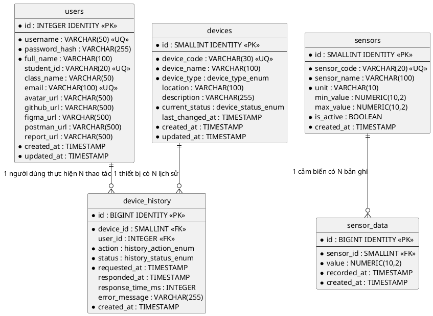

# THIẾT KẾ CƠ SỞ DỮ LIỆU

## HỆ THỐNG GIÁM SÁT NHIỆT ĐỘ, BẬT TẮT THIẾT BỊ PHÒNG HỌC

> Tài liệu này là phần thiết kế dữ liệu đi kèm **SRS – Hệ thống giám sát nhiệt độ, bật tắt thiết bị phòng học**.
> Hệ quản trị: **PostgreSQL 16** – Encoding `UTF8`, Collation `en_US.UTF-8`.
> Múi giờ lưu trữ: toàn bộ trường `TIMESTAMP` lưu theo giờ Việt Nam (UTC+7). Nếu triển khai nhiều múi giờ, đổi sang `TIMESTAMPTZ` và đặt `ALTER DATABASE classroom_iot SET timezone = 'Asia/Ho_Chi_Minh'`.

---

# 1. TỔNG QUAN

## 1.1 Danh sách bảng

| STT | Tên bảng         | Mô tả                                                                | Use case liên quan               |
| --: | ---------------- | -------------------------------------------------------------------- | -------------------------------- |
|   1 | `users`          | Thông tin tài khoản và hồ sơ người dùng                              | US01 Đăng nhập, US05 Profile     |
|   2 | `sensors`        | Danh mục cảm biến (nhiệt độ, ánh sáng, độ ẩm)                        | US02 Dashboard, US03 Data Sensor |
|   3 | `sensor_data`    | Các bản ghi giá trị cảm biến do IoT Device gửi lên                   | US02 Dashboard, US03 Data Sensor |
|   4 | `devices`        | Danh mục thiết bị điều khiển (quạt, bóng đèn) và trạng thái hiện tại | US02 Dashboard                   |
|   5 | `device_history` | Lịch sử thao tác bật/tắt thiết bị và kết quả phản hồi                | US02 Dashboard, US04 History     |

## 1.2 Sơ đồ quan hệ thực thể (ERD)



## 1.3 Bảng tổng hợp quan hệ

| STT | Bảng con         | Khóa ngoại  | Bảng cha  | Khóa tham chiếu | Quan hệ | ON DELETE | ON UPDATE | Ý nghĩa                                                      |
| --: | ---------------- | ----------- | --------- | --------------- | ------- | --------- | --------- | ------------------------------------------------------------ |
|   1 | `sensor_data`    | `sensor_id` | `sensors` | `id`            | N – 1   | RESTRICT  | CASCADE   | Mỗi bản ghi dữ liệu thuộc về một cảm biến                    |
|   2 | `device_history` | `device_id` | `devices` | `id`            | N – 1   | RESTRICT  | CASCADE   | Mỗi bản ghi lịch sử thuộc về một thiết bị                    |
|   3 | `device_history` | `user_id`   | `users`   | `id`            | N – 1   | SET NULL  | CASCADE   | Người dùng thực hiện thao tác (NULL nếu tự động/đã xóa user) |

---

# 2. ĐẶC TẢ CHI TIẾT CÁC BẢNG

## 2.1 Bảng `users` – Thông tin người dùng

**Vai trò:** Lưu thông tin tài khoản và hồ sơ của người dùng. Phục vụ chức năng Đăng nhập (US01) và trang Profile (US05).

| Field           | Data Type    | Key    | Not Null | Default                                       | Mô tả                                    |
| --------------- | ------------ | ------ | -------- | --------------------------------------------- | ---------------------------------------- |
| `id`            | INTEGER      | PK, AI | YES      | GENERATED ALWAYS AS IDENTITY                  | Khóa chính, tự tăng                      |
| `username`      | VARCHAR(50)  | UNIQUE | YES      | —                                             | Tên đăng nhập (dùng để login)            |
| `password_hash` | VARCHAR(255) |        | YES      | —                                             | Mật khẩu đã hash (bcrypt)                |
| `full_name`     | VARCHAR(100) |        | YES      | —                                             | Họ và tên đầy đủ (hiển thị trên Profile) |
| `student_id`    | VARCHAR(20)  | UNIQUE | NO       | NULL                                          | Mã sinh viên (Profile)                   |
| `class_name`    | VARCHAR(50)  |        | NO       | NULL                                          | Lớp học (Profile)                        |
| `email`         | VARCHAR(100) | UNIQUE | NO       | NULL                                          | Email (hiển thị trên Profile)            |
| `avatar_url`    | VARCHAR(500) |        | NO       | NULL                                          | Đường dẫn ảnh đại diện (Profile)         |
| `github_url`    | VARCHAR(500) |        | NO       | NULL                                          | Link GitHub (Profile)                    |
| `figma_url`     | VARCHAR(500) |        | NO       | NULL                                          | Link Figma (Profile)                     |
| `postman_url`   | VARCHAR(500) |        | NO       | NULL                                          | Link Postman (Profile)                   |
| `report_url`    | VARCHAR(500) |        | NO       | NULL                                          | Link báo cáo (Profile)                   |
| `created_at`    | TIMESTAMP    |        | YES      | CURRENT_TIMESTAMP                             | Thời điểm tạo tài khoản                  |
| `updated_at`    | TIMESTAMP    |        | YES      | CURRENT_TIMESTAMP + trigger `trg_users_updated_at` | Thời điểm cập nhật                  |

**Chỉ mục:**

| Tên chỉ mục         | Loại   | Cột               | Mục đích                                      |
| ------------------- | ------ | ----------------- | --------------------------------------------- |
| `pk_users`          | PK     | `id`              | Khóa chính                                    |
| `uq_username`       | UNIQUE | `username`        | Không trùng tên đăng nhập                     |
| `uq_email`          | UNIQUE | `email`           | Không trùng email                             |
| `uq_student_id`     | UNIQUE | `student_id`      | Không trùng mã sinh viên                      |
| `uq_username_lower` | UNIQUE | `LOWER(username)` | Không trùng tên đăng nhập khi bỏ qua hoa/thường |
| `uq_email_lower`    | UNIQUE | `LOWER(email)`    | Không trùng email khi bỏ qua hoa/thường       |

**Ràng buộc nghiệp vụ:**

- `username` không phân biệt hoa/thường khi đăng nhập, độ dài 4–50 ký tự. PostgreSQL so sánh chuỗi phân biệt hoa/thường nên quy tắc này được bảo đảm bằng unique index trên `LOWER(username)`; câu lệnh đăng nhập phải viết `WHERE LOWER(username) = LOWER($1)`.
- `password_hash` chỉ lưu chuỗi bcrypt (cost ≥ 10); hệ thống **không bao giờ** lưu mật khẩu thô và không trả trường này ra API.
- Các trường `*_url` nếu khác NULL phải là URL hợp lệ (`http://` hoặc `https://`). Nếu NULL, màn hình Profile hiển thị trạng thái “tài nguyên chưa được cấu hình” (mục 2.7.5.b SRS).

---

## 2.2 Bảng `sensors` – Danh mục cảm biến

**Vai trò:** Khai báo các cảm biến mà IoT Device gửi dữ liệu lên. Cung cấp tên hiển thị và đơn vị cho cột “Tên cảm biến”, “Giá trị cảm biến” của màn hình Data Sensor (US03) và các thẻ dữ liệu trên Dashboard (US02).

| Field         | Data Type     | Key    | Not Null | Default                      | Mô tả                                                                |
| ------------- | ------------- | ------ | -------- | ---------------------------- | -------------------------------------------------------------------- |
| `id`          | SMALLINT      | PK, AI | YES      | GENERATED ALWAYS AS IDENTITY | Khóa chính, tự tăng                                                  |
| `sensor_code` | VARCHAR(20)   | UNIQUE | YES      | —                            | Mã cảm biến dùng cho API/IoT: `temperature`, `light`, `humidity`     |
| `sensor_name` | VARCHAR(100)  |        | YES      | —                            | Tên hiển thị, ví dụ “Cảm biến nhiệt độ”                              |
| `unit`        | VARCHAR(10)   |        | YES      | —                            | Đơn vị đo: `°C`, `lux`, `%`                                          |
| `min_value`   | NUMERIC(10,2) |        | NO       | NULL                         | Ngưỡng nhỏ nhất hợp lệ, dùng để loại dữ liệu lỗi cảm biến            |
| `max_value`   | NUMERIC(10,2) |        | NO       | NULL                         | Ngưỡng lớn nhất hợp lệ                                               |
| `is_active`   | BOOLEAN       |        | YES      | TRUE                         | TRUE = đang sử dụng, FALSE = ngừng theo dõi (không hiển thị bộ lọc)  |
| `created_at`  | TIMESTAMP     |        | YES      | CURRENT_TIMESTAMP            | Thời điểm khai báo cảm biến                                          |

**Chỉ mục:**

| Tên chỉ mục      | Loại   | Cột           | Mục đích                            |
| ---------------- | ------ | ------------- | ----------------------------------- |
| `pk_sensors`     | PK     | `id`          | Khóa chính                          |
| `uq_sensor_code` | UNIQUE | `sensor_code` | Mỗi mã cảm biến chỉ tồn tại một lần |

**Ràng buộc nghiệp vụ:**

- `sensor_code` viết thường, không dấu, không khoảng trắng; là giá trị IoT Device dùng khi gửi dữ liệu (`POST /sensor-data`).
- Nếu `min_value`/`max_value` được cấu hình, giá trị ngoài khoảng sẽ bị từ chối khi ghi nhận (lỗi `SENSOR_VALUE_OUT_OF_RANGE`).
- Bảng này là **dữ liệu danh mục**, được nạp sẵn khi khởi tạo hệ thống, người dùng cuối không sửa.

---

## 2.3 Bảng `sensor_data` – Dữ liệu cảm biến

**Vai trò:** Lưu từng bản ghi giá trị cảm biến do IoT Device gửi lên. Là nguồn dữ liệu cho thẻ realtime, biểu đồ trên Dashboard (US02) và bảng tra cứu/lọc/sắp xếp/phân trang của Data Sensor (US03).

| Field         | Data Type     | Key    | Not Null | Default                      | Mô tả                                                                    |
| ------------- | ------------- | ------ | -------- | ---------------------------- | ------------------------------------------------------------------------ |
| `id`          | BIGINT        | PK, AI | YES      | GENERATED ALWAYS AS IDENTITY | Khóa chính, tự tăng – cột `ID` trên bảng Data Sensor, không cho nhập tay |
| `sensor_id`   | SMALLINT      | FK     | YES      | —                            | Cảm biến tương ứng, tham chiếu `sensors(id)`                             |
| `value`       | NUMERIC(10,2) |        | YES      | —                            | Giá trị đo được, ví dụ `28.50` (°C), `650.00` (lux)                      |
| `recorded_at` | TIMESTAMP     |        | YES      | —                            | Thời điểm thiết bị **đo** dữ liệu – cột `Time` dùng để tìm kiếm/sắp xếp  |
| `created_at`  | TIMESTAMP     |        | YES      | CURRENT_TIMESTAMP            | Thời điểm hệ thống **nhận** được dữ liệu (dùng đối chiếu độ trễ)         |

**Chỉ mục:**

| Tên chỉ mục           | Loại  | Cột                          | Mục đích                                                             |
| --------------------- | ----- | ---------------------------- | -------------------------------------------------------------------- |
| `pk_sensor_data`      | PK    | `id`                         | Khóa chính, mặc định sắp xếp theo ID                                 |
| `idx_sensor_recorded` | INDEX | (`sensor_id`, `recorded_at`) | Lấy giá trị mới nhất theo cảm biến, vẽ biểu đồ theo khoảng thời gian |
| `idx_recorded_at`     | INDEX | `recorded_at`                | Tìm kiếm/sắp xếp theo thời gian trên toàn bộ cảm biến                |
| `idx_sensor_value`    | INDEX | (`sensor_id`, `value`)       | Lọc theo khoảng giá trị (Temperature Min/Max, Light Min/Max)         |

**Ràng buộc nghiệp vụ:**

- Tìm kiếm theo thời gian rút gọn (`2026`, `2026/08`, `2026/08/17 07:30`) được quy đổi thành khoảng `[from, to)` trên `recorded_at`; **sắp xếp luôn dựa trên `recorded_at` đầy đủ đến giây**, không dựa trên chuỗi người dùng nhập (mục 2.6.3 SRS).
- Hệ thống **không tự sinh dữ liệu giả**: khi bảng rỗng, Dashboard hiển thị “Chưa có dữ liệu” (mục 2.7.2.b SRS).
- Bảng tăng trưởng nhanh (mỗi cảm biến khoảng 1 bản ghi/20 giây). Khuyến nghị dùng declarative partitioning của PostgreSQL (`PARTITION BY RANGE (recorded_at)` theo tháng) hoặc job xóa dữ liệu cũ hơn 90 ngày.

---

## 2.4 Bảng `devices` – Danh mục thiết bị điều khiển

**Vai trò:** Khai báo các thiết bị điện có thể bật/tắt (quạt, bóng đèn) và **trạng thái hiện tại** của từng thiết bị. Phục vụ khu vực điều khiển của Dashboard (US02) và bộ lọc `Device` của History (US04).

| Field             | Data Type            | Key    | Not Null | Default                                              | Mô tả                                                    |
| ----------------- | -------------------- | ------ | -------- | ---------------------------------------------------- | -------------------------------------------------------- |
| `id`              | SMALLINT             | PK, AI | YES      | GENERATED ALWAYS AS IDENTITY                         | Khóa chính, tự tăng                                      |
| `device_code`     | VARCHAR(30)          | UNIQUE | YES      | —                                                    | Mã thiết bị dùng cho API/IoT: `fan-01`, `light-board`, … |
| `device_name`     | VARCHAR(100)         |        | YES      | —                                                    | Tên hiển thị, ví dụ “Quạt 1”, “Đèn bảng”                 |
| `device_type`     | `device_type_enum`   |        | YES      | —                                                    | Loại thiết bị: `FAN` hoặc `LIGHT`                        |
| `location`        | VARCHAR(100)         |        | NO       | NULL                                                 | Vị trí trong phòng học, ví dụ “Dãy trái”                 |
| `description`     | VARCHAR(255)         |        | NO       | NULL                                                 | Mô tả chức năng, ví dụ “Làm mát khu vực dãy trái”        |
| `current_status`  | `device_status_enum` |        | YES      | 'OFF'                                                | Trạng thái hiển thị hiện tại: `ON`/`OFF`/`LOADING`       |
| `last_changed_at` | TIMESTAMP            |        | NO       | NULL                                                 | Thời điểm trạng thái được thiết bị xác nhận gần nhất     |
| `created_at`      | TIMESTAMP            |        | YES      | CURRENT_TIMESTAMP                                    | Thời điểm khai báo thiết bị                              |
| `updated_at`      | TIMESTAMP            |        | YES      | CURRENT_TIMESTAMP + trigger `trg_devices_updated_at` | Thời điểm cập nhật bản ghi                               |

**Chỉ mục:**

| Tên chỉ mục       | Loại   | Cột           | Mục đích                               |
| ----------------- | ------ | ------------- | -------------------------------------- |
| `pk_devices`      | PK     | `id`          | Khóa chính                             |
| `uq_device_code`  | UNIQUE | `device_code` | Mỗi mã thiết bị chỉ tồn tại một lần    |
| `idx_device_type` | INDEX  | `device_type` | Lọc theo loại thiết bị (Quạt/Bóng đèn) |

**Ràng buộc nghiệp vụ:**

- `current_status` = `LOADING` khi hệ thống đã gửi lệnh nhưng **chưa nhận phản hồi** từ IoT Device.
- Nếu quá thời gian chờ (mặc định 10 giây) mà không có phản hồi, `current_status` được đưa **về trạng thái đã xác nhận gần nhất** (mục 2.6.2 – luồng thay thế 7a), còn bản ghi lịch sử tương ứng chuyển sang `FAILED`.
- `last_changed_at` chỉ cập nhật khi trạng thái được thiết bị xác nhận là `ON`/`OFF`, không cập nhật khi `LOADING`.

---

## 2.5 Bảng `device_history` – Lịch sử bật/tắt thiết bị

**Vai trò:** Ghi nhận mọi thao tác điều khiển và kết quả phản hồi từ IoT Device. Là nguồn dữ liệu cho màn hình History (US04) với đầy đủ tìm kiếm theo thời gian, lọc theo Device/Action/Status, sắp xếp và phân trang.

| Field              | Data Type             | Key    | Not Null | Default                      | Mô tả                                                                    |
| ------------------ | --------------------- | ------ | -------- | ---------------------------- | ------------------------------------------------------------------------ |
| `id`               | BIGINT                | PK, AI | YES      | GENERATED ALWAYS AS IDENTITY | Khóa chính, tự tăng – cột `ID` trên bảng History                         |
| `device_id`        | SMALLINT              | FK     | YES      | —                            | Thiết bị được điều khiển, tham chiếu `devices(id)`                       |
| `user_id`          | INTEGER               | FK     | NO       | NULL                         | Người dùng thực hiện thao tác, tham chiếu `users(id)`; NULL nếu hệ thống |
| `action`           | `history_action_enum` |        | YES      | —                            | Hành động yêu cầu: `ON` hoặc `OFF` – cột `Action`                        |
| `status`           | `history_status_enum` |        | YES      | 'LOADING'                    | Kết quả thao tác: `LOADING`/`ON`/`OFF`/`FAILED` – cột `Status`           |
| `requested_at`     | TIMESTAMP             |        | YES      | CURRENT_TIMESTAMP            | Thời điểm người dùng gửi lệnh – cột `Time` dùng để tìm kiếm/sắp xếp      |
| `responded_at`     | TIMESTAMP             |        | NO       | NULL                         | Thời điểm IoT Device phản hồi; NULL khi còn `LOADING`                    |
| `response_time_ms` | INTEGER               |        | NO       | NULL                         | Thời gian phản hồi (ms) = `responded_at` − `requested_at`; CHECK ≥ 0     |
| `error_message`    | VARCHAR(255)          |        | NO       | NULL                         | Lý do thất bại khi `status = FAILED`                                     |
| `created_at`       | TIMESTAMP             |        | YES      | CURRENT_TIMESTAMP            | Thời điểm tạo bản ghi                                                    |

**Chỉ mục:**

| Tên chỉ mục            | Loại  | Cột                           | Mục đích                                  |
| ---------------------- | ----- | ----------------------------- | ----------------------------------------- |
| `pk_device_history`    | PK    | `id`                          | Khóa chính, mặc định sắp xếp theo ID      |
| `idx_requested_at`     | INDEX | `requested_at`                | Tìm kiếm/sắp xếp theo thời gian           |
| `idx_device_requested` | INDEX | (`device_id`, `requested_at`) | Lọc theo thiết bị kết hợp thời gian       |
| `idx_status`           | INDEX | `status`                      | Lọc theo trạng thái ON/LOADING/OFF/FAILED |
| `idx_action`           | INDEX | `action`                      | Lọc theo hành động ON/OFF                 |
| `idx_user`             | INDEX | `user_id`                     | Truy vết thao tác theo người dùng         |

**Ràng buộc nghiệp vụ:**

| Trạng thái | Điều kiện                                                     | `responded_at`     | `response_time_ms` |
| ---------- | ------------------------------------------------------------- | ------------------ | ------------------ |
| `LOADING`  | Đã gửi lệnh, đang chờ IoT Device phản hồi                     | NULL               | NULL               |
| `ON`       | Thiết bị xác nhận đã bật (ứng với `action = ON`)              | NOT NULL           | NOT NULL           |
| `OFF`      | Thiết bị xác nhận đã tắt (ứng với `action = OFF`)             | NOT NULL           | NOT NULL           |
| `FAILED`   | Không gửi được lệnh hoặc hết thời gian chờ phản hồi (timeout) | NULL hoặc NOT NULL | Thời gian đã chờ   |

- Bản ghi được tạo ngay khi người dùng bấm toggle (status = `LOADING`), sau đó **cập nhật tại chỗ** khi có phản hồi – đảm bảo History phản ánh đúng mục 2.6.2 bước 9.
- Không cho phép xóa bản ghi lịch sử; đây là dữ liệu chỉ ghi thêm (append-only) phục vụ truy vết.

---

# 3. MÃ LỆNH TẠO CƠ SỞ DỮ LIỆU (DDL)

> PostgreSQL không có `CREATE DATABASE IF NOT EXISTS` và không có lệnh `USE`. Tạo database trước, sau đó kết nối vào rồi mới chạy phần DDL.

```sql
-- =============================================================
-- Hệ thống giám sát nhiệt độ, bật tắt thiết bị phòng học
-- PostgreSQL 16
-- =============================================================

-- Chạy ở database mặc định (postgres):
CREATE DATABASE classroom_iot ENCODING 'UTF8' TEMPLATE template0;

-- CURRENT_TIMESTAMP/NOW() quy đổi theo múi giờ của phiên làm việc, nên phải
-- cố định múi giờ để mọi giá trị mặc định đều là giờ Việt Nam:
ALTER DATABASE classroom_iot SET timezone = 'Asia/Ho_Chi_Minh';

-- Kết nối vào database vừa tạo (psql):
-- \c classroom_iot

-- -------------------------------------------------------------
-- 0a. Kiểu ENUM (PostgreSQL không cho khai báo ENUM ngay tại cột)
-- -------------------------------------------------------------
CREATE TYPE device_type_enum    AS ENUM ('FAN', 'LIGHT');
CREATE TYPE device_status_enum  AS ENUM ('ON', 'OFF', 'LOADING');
CREATE TYPE history_action_enum AS ENUM ('ON', 'OFF');
CREATE TYPE history_status_enum AS ENUM ('LOADING', 'ON', 'OFF', 'FAILED');

-- -------------------------------------------------------------
-- 0b. Hàm dùng chung cho trigger cập nhật updated_at
-- -------------------------------------------------------------
CREATE FUNCTION set_updated_at() RETURNS TRIGGER AS $$
BEGIN
  NEW.updated_at := CURRENT_TIMESTAMP;
  RETURN NEW;
END;
$$ LANGUAGE plpgsql;

-- -------------------------------------------------------------
-- 1. users
-- -------------------------------------------------------------
CREATE TABLE users (
  id            INTEGER      GENERATED ALWAYS AS IDENTITY,
  username      VARCHAR(50)  NOT NULL,
  password_hash VARCHAR(255) NOT NULL,
  full_name     VARCHAR(100) NOT NULL,
  student_id    VARCHAR(20)  DEFAULT NULL,
  class_name    VARCHAR(50)  DEFAULT NULL,
  email         VARCHAR(100) DEFAULT NULL,
  avatar_url    VARCHAR(500) DEFAULT NULL,
  github_url    VARCHAR(500) DEFAULT NULL,
  figma_url     VARCHAR(500) DEFAULT NULL,
  postman_url   VARCHAR(500) DEFAULT NULL,
  report_url    VARCHAR(500) DEFAULT NULL,
  created_at    TIMESTAMP    NOT NULL DEFAULT CURRENT_TIMESTAMP,
  updated_at    TIMESTAMP    NOT NULL DEFAULT CURRENT_TIMESTAMP,
  CONSTRAINT pk_users      PRIMARY KEY (id),
  CONSTRAINT uq_username   UNIQUE (username),
  CONSTRAINT uq_email      UNIQUE (email),
  CONSTRAINT uq_student_id UNIQUE (student_id)
);

CREATE UNIQUE INDEX uq_username_lower ON users (LOWER(username));
CREATE UNIQUE INDEX uq_email_lower    ON users (LOWER(email));

CREATE TRIGGER trg_users_updated_at
  BEFORE UPDATE ON users
  FOR EACH ROW EXECUTE FUNCTION set_updated_at();

-- -------------------------------------------------------------
-- 2. sensors
-- -------------------------------------------------------------
CREATE TABLE sensors (
  id          SMALLINT      GENERATED ALWAYS AS IDENTITY,
  sensor_code VARCHAR(20)   NOT NULL,
  sensor_name VARCHAR(100)  NOT NULL,
  unit        VARCHAR(10)   NOT NULL,
  min_value   NUMERIC(10,2) DEFAULT NULL,
  max_value   NUMERIC(10,2) DEFAULT NULL,
  is_active   BOOLEAN       NOT NULL DEFAULT TRUE,
  created_at  TIMESTAMP     NOT NULL DEFAULT CURRENT_TIMESTAMP,
  CONSTRAINT pk_sensors     PRIMARY KEY (id),
  CONSTRAINT uq_sensor_code UNIQUE (sensor_code)
);

-- -------------------------------------------------------------
-- 3. sensor_data
-- -------------------------------------------------------------
CREATE TABLE sensor_data (
  id          BIGINT        GENERATED ALWAYS AS IDENTITY,
  sensor_id   SMALLINT      NOT NULL,
  value       NUMERIC(10,2) NOT NULL,
  recorded_at TIMESTAMP     NOT NULL,
  created_at  TIMESTAMP     NOT NULL DEFAULT CURRENT_TIMESTAMP,
  CONSTRAINT pk_sensor_data PRIMARY KEY (id),
  CONSTRAINT fk_sensor_data_sensor
    FOREIGN KEY (sensor_id) REFERENCES sensors (id)
    ON DELETE RESTRICT ON UPDATE CASCADE
);

CREATE INDEX idx_sensor_recorded ON sensor_data (sensor_id, recorded_at);
CREATE INDEX idx_recorded_at     ON sensor_data (recorded_at);
CREATE INDEX idx_sensor_value    ON sensor_data (sensor_id, value);

-- -------------------------------------------------------------
-- 4. devices
-- -------------------------------------------------------------
CREATE TABLE devices (
  id              SMALLINT           GENERATED ALWAYS AS IDENTITY,
  device_code     VARCHAR(30)        NOT NULL,
  device_name     VARCHAR(100)       NOT NULL,
  device_type     device_type_enum   NOT NULL,
  location        VARCHAR(100)       DEFAULT NULL,
  description     VARCHAR(255)       DEFAULT NULL,
  current_status  device_status_enum NOT NULL DEFAULT 'OFF',
  last_changed_at TIMESTAMP          DEFAULT NULL,
  created_at      TIMESTAMP          NOT NULL DEFAULT CURRENT_TIMESTAMP,
  updated_at      TIMESTAMP          NOT NULL DEFAULT CURRENT_TIMESTAMP,
  CONSTRAINT pk_devices     PRIMARY KEY (id),
  CONSTRAINT uq_device_code UNIQUE (device_code)
);

CREATE INDEX idx_device_type ON devices (device_type);

CREATE TRIGGER trg_devices_updated_at
  BEFORE UPDATE ON devices
  FOR EACH ROW EXECUTE FUNCTION set_updated_at();

-- -------------------------------------------------------------
-- 5. device_history
-- -------------------------------------------------------------
CREATE TABLE device_history (
  id               BIGINT              GENERATED ALWAYS AS IDENTITY,
  device_id        SMALLINT            NOT NULL,
  user_id          INTEGER             DEFAULT NULL,
  action           history_action_enum NOT NULL,
  status           history_status_enum NOT NULL DEFAULT 'LOADING',
  requested_at     TIMESTAMP           NOT NULL DEFAULT CURRENT_TIMESTAMP,
  responded_at     TIMESTAMP           DEFAULT NULL,
  response_time_ms INTEGER             DEFAULT NULL,
  error_message    VARCHAR(255)        DEFAULT NULL,
  created_at       TIMESTAMP           NOT NULL DEFAULT CURRENT_TIMESTAMP,
  CONSTRAINT pk_device_history PRIMARY KEY (id),
  CONSTRAINT ck_response_time_ms
    CHECK (response_time_ms IS NULL OR response_time_ms >= 0),
  CONSTRAINT fk_history_device
    FOREIGN KEY (device_id) REFERENCES devices (id)
    ON DELETE RESTRICT ON UPDATE CASCADE,
  CONSTRAINT fk_history_user
    FOREIGN KEY (user_id) REFERENCES users (id)
    ON DELETE SET NULL ON UPDATE CASCADE
);

CREATE INDEX idx_requested_at     ON device_history (requested_at);
CREATE INDEX idx_device_requested ON device_history (device_id, requested_at);
CREATE INDEX idx_status           ON device_history (status);
CREATE INDEX idx_action           ON device_history (action);
CREATE INDEX idx_user             ON device_history (user_id);
```

**Khác biệt so với bản MySQL trước đây:**

| MySQL 8.0                                     | PostgreSQL 16                                        |
| --------------------------------------------- | ---------------------------------------------------- |
| `CREATE DATABASE ... CHARACTER SET utf8mb4`   | `CREATE DATABASE ... ENCODING 'UTF8'`                |
| `USE classroom_iot;`                          | `\c classroom_iot` (lệnh của psql, không phải SQL)   |
| `INT/TINYINT/BIGINT UNSIGNED`                 | `INTEGER` / `SMALLINT` / `BIGINT` (không có UNSIGNED) |
| `AUTO_INCREMENT`                              | `GENERATED ALWAYS AS IDENTITY`                       |
| `ENUM(...)` khai báo tại cột                  | `CREATE TYPE ... AS ENUM (...)` dùng lại ở nhiều cột |
| `DATETIME`                                    | `TIMESTAMP` (hoặc `TIMESTAMPTZ`)                     |
| `DECIMAL(10,2)`                               | `NUMERIC(10,2)`                                      |
| `TINYINT(1)` làm cờ bật/tắt                   | `BOOLEAN`                                            |
| `ON UPDATE CURRENT_TIMESTAMP`                 | Trigger `BEFORE UPDATE` gọi `set_updated_at()`       |
| `KEY idx_x (...)` bên trong `CREATE TABLE`    | `CREATE INDEX idx_x ON ...` tách riêng               |
| `UNIQUE KEY uq_x (col)`                       | `CONSTRAINT uq_x UNIQUE (col)`                       |
| Collation `*_ci` ⇒ so sánh không phân biệt hoa/thường | Unique index trên `LOWER(col)` + `WHERE LOWER(col) = LOWER($1)` |
| `ENGINE = InnoDB`                             | Bỏ (PostgreSQL chỉ có một storage engine)            |

---

# 4. DỮ LIỆU KHỞI TẠO (SEED)

```sql
-- Chạy sau khi đã kết nối vào database classroom_iot

-- Tài khoản mẫu (mật khẩu: 123456 – cần thay hash thật khi triển khai)
INSERT INTO users
  (username, password_hash, full_name, student_id, class_name, email,
   avatar_url, github_url, figma_url, postman_url, report_url)
VALUES
  ('admin',
   '$2b$10$REPLACE_WITH_REAL_BCRYPT_HASH_OF_YOUR_PASSWORD',
   'Anh Tran', 'B21DCCN001', 'D21CQCN01-B',
   'anhtran@student.ptit.edu.vn',
   '/avatars/shadcn.jpg',
   'https://github.com/',
   'https://figma.com/',
   NULL,
   NULL);

-- Danh mục cảm biến
INSERT INTO sensors (sensor_code, sensor_name, unit, min_value, max_value) VALUES
  ('temperature', 'Cảm biến nhiệt độ', '°C',  -10.00,     80.00),
  ('light',       'Cảm biến ánh sáng', 'lux',   0.00, 100000.00),
  ('humidity',    'Cảm biến độ ẩm',    '%',     0.00,    100.00);

-- Danh mục thiết bị
INSERT INTO devices (device_code, device_name, device_type, location, description, current_status) VALUES
  ('fan-01',      'Quạt 1',       'FAN',   'Dãy trái',     'Làm mát khu vực dãy trái', 'OFF'),
  ('fan-02',      'Quạt 2',       'FAN',   'Dãy phải',     'Làm mát khu vực dãy phải', 'OFF'),
  ('light-board', 'Đèn bảng',     'LIGHT', 'Khu vực bảng', 'Chiếu sáng khu vực bảng',  'OFF'),
  ('light-left',  'Đèn dãy trái', 'LIGHT', 'Dãy trái',     'Chiếu sáng dãy bàn trái',  'OFF'),
  ('light-right', 'Đèn dãy phải', 'LIGHT', 'Dãy phải',     'Chiếu sáng dãy bàn phải',  'OFF');
```

---

# 5. CÁC TRUY VẤN NGHIỆP VỤ TIÊU BIỂU

> Tham số viết dưới dạng `:param` cho dễ đọc. Khi chạy bằng `node-postgres` phải đổi sang `$1, $2, …`; các tham số có thể NULL cần ép kiểu (`$1::text`) để PostgreSQL suy luận được kiểu.

## 5.1 Giá trị cảm biến mới nhất cho Dashboard

```sql
SELECT DISTINCT ON (s.id)
       s.sensor_code, s.sensor_name, s.unit, d.value, d.recorded_at
FROM sensors s
JOIN sensor_data d ON d.sensor_id = s.id
WHERE s.is_active = TRUE
ORDER BY s.id, d.recorded_at DESC, d.id DESC;
```

## 5.2 Dữ liệu vẽ biểu đồ 2 giờ gần nhất (dạng pivot)

```sql
SELECT d.recorded_at,
       MAX(CASE WHEN s.sensor_code = 'temperature' THEN d.value END) AS temperature,
       MAX(CASE WHEN s.sensor_code = 'light'       THEN d.value END) AS light,
       MAX(CASE WHEN s.sensor_code = 'humidity'    THEN d.value END) AS humidity
FROM sensor_data d
JOIN sensors s ON s.id = d.sensor_id
WHERE d.recorded_at >= LOCALTIMESTAMP - INTERVAL '2 hours'
GROUP BY d.recorded_at
ORDER BY d.recorded_at;
```

## 5.3 Data Sensor – tìm theo thời gian rút gọn `2026/08/17 07` kết hợp lọc giá trị

```sql
SELECT d.id, s.sensor_name, d.value, s.unit, d.recorded_at
FROM sensor_data d
JOIN sensors s ON s.id = d.sensor_id
WHERE d.recorded_at >= TIMESTAMP '2026-08-17 07:00:00'
  AND d.recorded_at <  TIMESTAMP '2026-08-17 08:00:00'
  AND (:sensor_code::text    IS NULL OR s.sensor_code = :sensor_code)
  AND (:value_min::numeric   IS NULL OR d.value >= :value_min)
  AND (:value_max::numeric   IS NULL OR d.value <= :value_max)
ORDER BY d.recorded_at DESC, d.id DESC
LIMIT :limit OFFSET :offset;
```

## 5.4 History – lọc kết hợp thiết bị, hành động, trạng thái

```sql
SELECT h.id, dv.device_code, dv.device_name, h.action, h.status,
       h.response_time_ms, h.requested_at, u.full_name
FROM device_history h
JOIN devices dv ON dv.id = h.device_id
LEFT JOIN users u ON u.id = h.user_id
WHERE (:device_code::text IS NULL OR dv.device_code = :device_code)
  AND (:device_type::text IS NULL OR dv.device_type = :device_type::device_type_enum)
  AND (:action::text      IS NULL OR h.action      = :action::history_action_enum)
  AND (:status::text      IS NULL OR h.status      = :status::history_status_enum)
  AND (:from::timestamp   IS NULL OR h.requested_at >= :from)
  AND (:to::timestamp     IS NULL OR h.requested_at <  :to)
ORDER BY h.requested_at DESC, h.id DESC
LIMIT :limit OFFSET :offset;
```

## 5.5 Job đánh dấu timeout cho lệnh không có phản hồi

```sql
-- Chạy mỗi 5 giây; ngưỡng chờ 10 giây
UPDATE device_history
SET status = 'FAILED',
    response_time_ms = FLOOR(EXTRACT(EPOCH FROM (LOCALTIMESTAMP - requested_at)) * 1000)::int,
    error_message = 'Không nhận được phản hồi từ thiết bị'
WHERE status = 'LOADING'
  AND requested_at < LOCALTIMESTAMP - INTERVAL '10 seconds';
```

> Dùng `LOCALTIMESTAMP` (kiểu `timestamp`) thay vì `NOW()` (kiểu `timestamptz`) để so sánh cùng kiểu với các cột thời gian, tránh phụ thuộc vào việc quy đổi múi giờ ngầm định.

---

# 6. ÁNH XẠ DỮ LIỆU – GIAO DIỆN

| Màn hình    | Thành phần giao diện                                          | Nguồn dữ liệu                                                                                                                                                                     |
| ----------- | ------------------------------------------------------------- | --------------------------------------------------------------------------------------------------------------------------------------------------------------------------------- |
| Đăng nhập   | Username, Password                                            | `users.username`, `users.password_hash`                                                                                                                                           |
| Dashboard   | Temperature Card                                              | `sensor_data.value` mới nhất của `sensors.sensor_code='temperature'`                                                                                                               |
| Dashboard   | Light Card                                                    | `sensor_data.value` mới nhất của `sensors.sensor_code='light'`                                                                                                                     |
| Dashboard   | Humidity Card                                                 | `sensor_data.value` mới nhất của `sensors.sensor_code='humidity'`                                                                                                                  |
| Dashboard   | Thời gian cập nhật                                            | `sensor_data.recorded_at`                                                                                                                                                         |
| Dashboard   | Biểu đồ cảm biến                                              | `sensor_data` nhóm theo `recorded_at`                                                                                                                                             |
| Dashboard   | Device Card + Toggle                                          | `devices.device_name`, `devices.current_status`                                                                                                                                    |
| Data Sensor | Cột ID / Tên cảm biến / Giá trị / Thời gian                    | `sensor_data.id`, `sensors.sensor_name`, `sensor_data.value` + `sensors.unit`, `sensor_data.recorded_at`                                                                           |
| Data Sensor | Bộ lọc cảm biến                                               | `sensors.sensor_code`                                                                                                                                                             |
| History     | Cột ID / Device / Action / Status / Thời gian phản hồi / Time  | `device_history.id`, `devices.device_name`, `device_history.action`, `device_history.status`, `device_history.response_time_ms`, `device_history.requested_at`                      |
| Profile     | Avatar, Full Name, Student Code, Class, Email                 | `users.avatar_url`, `users.full_name`, `users.student_id`, `users.class_name`, `users.email`                                                                                       |
| Profile     | GitHub / Figma / Postman / Report                             | `users.github_url`, `users.figma_url`, `users.postman_url`, `users.report_url`                                                                                                     |

**KẾT THÚC TÀI LIỆU THIẾT KẾ CƠ SỞ DỮ LIỆU**
